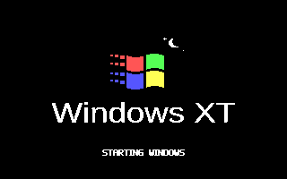
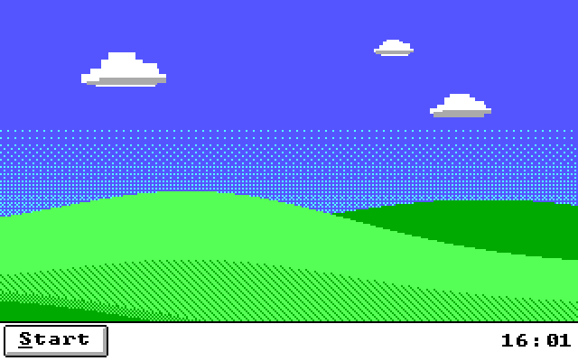
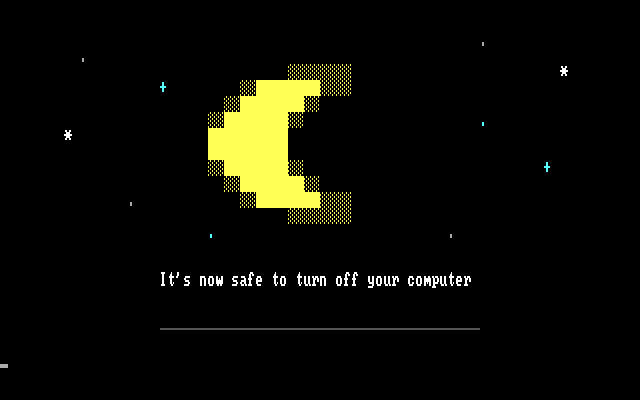
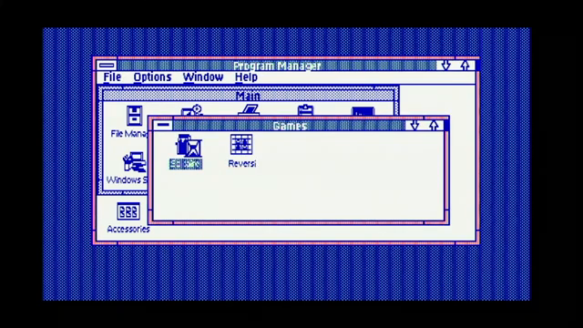
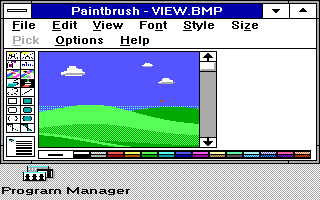
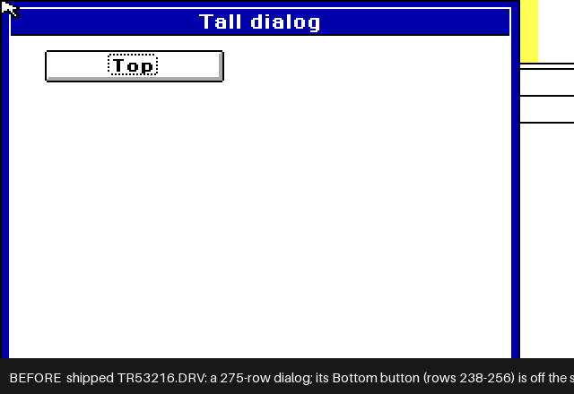
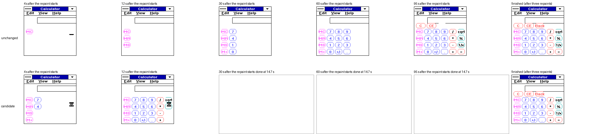
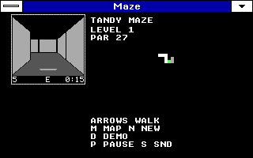

# Windows XT

**A colorful little Windows desktop for an 8088 Tandy.**

Windows XT brings color graphics, a compact Start-menu desktop, games and
utilities to Windows 3.0 on the original Tandy 1000 EX/HX.

**[Watch the Windows XT overview video](https://youtu.be/A1i9R6zSxHY)** — a look at the 16-color
Windows 3.0 desktop.

| Startup | Desktop | Shutdown |
| --- | --- | --- |
|  |  |  |

[Get started](#get-started) · [Other machines](docs/PLATFORM.MD) ·
[More screenshots and capture notes](docs/SHOWCASE.MD)

## Get started

For an **original Tandy 1000 EX/HX with normal 640 KB and Windows 3.0 real mode**:

**[Download the Windows XT pack](https://github.com/astrobleem/oemdisplay-tandy/releases/download/windows-xt/WXTF1107.ZIP).**
It contains `SETUP.EXE`, `README.TXT` and an expanded `WINXT` folder.

- **Full desktop:** run `SETUP UPDATE C:\WINDOWS` or `SETUP FRESH A:\` on DOS.
  Use `C:\STARTXT` afterward.
- **Drivers only:** point Windows Setup at the same expanded `WINXT` folder,
  without running the custom installer.

New installations default to **fixed 320x200, sixteen colors, without panning**.
Updates preserve the installed display choice. The pack also includes optimized
640x200 four-color, 320x200 four-color, 160x200 sixteen-color and 640x200
monochrome drivers, selected through Windows Setup. HPXY panning is unchanged.
[Current release notes](https://github.com/astrobleem/oemdisplay-tandy/releases/tag/windows-xt) ·
[Installation](docs/DESKTOP.MD) · [Panning settings](docs/PANNING.MD).

Other hardware profiles and apps are in [current downloads](docs/DOWNLOADS.MD).
Each product has one current packet and a short install guide.

## Narrow System font and optional application fonts

The pack includes the narrower **M** and **W** System glyphs while keeping
Windows 3.0's original dialog spacing. Updates replace recognized XTCSYS files
when selected for HPXY or one of the four XTC fixed modes; fresh fixed
320x200 sixteen-color installations keep their XTE fonts. Custom font choices
and application font registrations are preserved.

Six optional Tandy fonts provide **XT Tandy I**, **XT Tandy II** and
**XT Tandy 2K** in 8-row and 12-row forms. Full Setup places them in
`C:\WINXT\FONTS`; add the ones you want through **Control Panel > Fonts > Add**.
Three compact Helv fonts are also included, but share the existing Helv family.
Leave those unselected if you want to keep your present Helv installation.
[Font details and installation](docs/FONTS/README.MD).

## One panning application

**[Download PAN.ZIP](https://github.com/astrobleem/oemdisplay-tandy/releases/download/windows-xt/PAN.ZIP)**
for an existing supported display installation. The current Windows XT, CGA,
PCjr and ColorPlus packets already include it.

Run **PAN /SETTINGS** or press **Ctrl+Alt+S**. PAN detects the installed driver
and starts its appropriate backend, with one settings dialog and the same queued
keyboard controls. Tandy extended displays keep their software/hardware choice;
fixed displays use the window workspace. There is no separate helper to choose
or copy. [Installation, controls and supported displays](docs/PANNING.MD).

## IBM CGA graphics

**[Download CGA.ZIP](https://github.com/astrobleem/oemdisplay-tandy/releases/download/windows-xt/CGA.ZIP)**
for fixed or panning 160x100 with 16 RGBI colors and compact fonts/controls, 320x200 four-color,
or 640x200 monochrome. Standard and compact UI choices for 320 and 640
are listed in the DOS installer menu; fonts and support files are included.
For a new Windows installation, the kit's **FRESH** launcher uses your original
Windows 3.0 media and the project's 640x200 monochrome driver during Setup.
[Installation and emulator qualification scope](docs/CGA.MD). Physical hardware
and composite output remain unqualified.

## A larger desktop on PCjr and ColorPlus

A **640x400 desktop through a 320x200, 16-color viewport** is available
for these adapters. Both axes move, using the same PAN application as the other
supported displays. The hardware packets also retain their fixed-mode choice.

**[PCjr download](https://github.com/astrobleem/oemdisplay-tandy/releases/download/windows-xt/JRPAN.ZIP)** | **[ColorPlus download](https://github.com/astrobleem/oemdisplay-tandy/releases/download/windows-xt/CPPAN.ZIP)** |
[Short install instructions](docs/SOFTPAN/RELEASE.MD) | [Current native evidence](docs/QUAL/PAN/README.MD)

These use a 128,000-byte software shadow, 64 KB more than the earlier
vertical-only desktop. Native checks cover DOSBox-X PCjr and 86Box
XT/Plantronics with normal 640 KB. Physical hardware remains unqualified.

The current **ColorPlus fixed driver and standalone Yamaha B800h driver** also
include [new drawing optimizations](https://github.com/astrobleem/oemdisplay-tandy/pull/216).
ColorPlus panning and the separate Olivetti PC1 driver are unchanged by that update.

## More color, compact controls

| Before: Windows 3.0, four colors | Windows XT: sixteen colors |
| --- | --- |
|  |  |

- Tandy Start: Programs, My Computer, Run/Browse and a clock.
- Original XT Pixels bitmap fonts and compact controls.
- [Copy DOS text and graphics into Windows](docs/GRABBER.MD) with Shift+Print.
- Read existing long filenames on compatible DOS 6.22 FAT volumes.
- A DOS display-mode menu with undo and interrupted-switch recovery.
- Optional Hold-to-Start with the [compatible keyboard driver](src/tandyk3/README.md).

The optional **HPXY profile** shows a **640x256 desktop through a 320x200,
sixteen-color view**. Keyboard panning brings off-screen windows into reach.
[Display controls and installation](docs/DRIVERS.MD) ·
[Original fonts](docs/FONTS/README.MD)

For a fixed-resolution desktop, choose the [fixed profiles](docs/FIXED.MD).

## More room to play

These panning captures retain their original, separately documented test scope.

| More room for windows | A board beyond the screen |
| --- | --- |
|  |  |

Use Ctrl+Alt+arrows to pan and Ctrl+Alt+Home to return home. PAN /SETTINGS selects software or hardware presentation where the driver supports both.
[Install Minesweeper](https://github.com/astrobleem/oemdisplay-tandy/releases/download/windows-xt/MINESET.ZIP) ·
[Install guide](tools/CURRENT/GUIDES/MINESET.TXT) · [Capture notes](docs/pan/MINE/CAPTURE.MD).

## Optimized fixed displays

The pack includes all five fixed Tandy profiles. It retains the already-fast
320x200 sixteen-color release driver and extends its compatible drawing
optimizations to the other four modes.

| Display mode | Calculator repaint |
| --- | ---: |
| 320x200, sixteen colors | 0.989 s |
| 640x200, four colors | 0.494 s |
| 320x200, four colors | 0.604 s |
| 160x200, sixteen colors | 0.769 s |
| 640x200, monochrome | 0.440 s |

These are medians of three full client repaints in Windows 3.0, DOSBox-X with
a normal core, `8086_prefetch`, fixed 3000 cycles and 640 KB. Compare within a
mode, since window sizes differ. They are not physical-hardware timings or a
new speedup over the previous fixed320 release. Existing low-resolution
Calculator layout crowding/clipping is unchanged.
These timings used the preceding System font; the font update is not a new
performance result.

All 235 Calculator, text/GDI and polyline framebuffer comparisons matched their
corresponding baseline. Another 250 native bitmap/RLE cases matched video,
DDB readbacks and return values. The combined pack passed native preparation,
update, migration, repair and Computer completion checks. All four savers
passed preview, keyboard wake and unload in all five modes; automatic idle
re-arm was checked with Cube in each mode.
The original Windows Setup wizard and physical hardware were not rerun for
that driver/saver update. The font update has its own
[installation and native-test scope](docs/FONTS/README.MD#current-font-integration-checks).

[Source changes](https://github.com/astrobleem/oemdisplay-tandy/pull/218) use
[`BUILDCALC.PY`](src/tandysw/BUILDCALC.PY) with the same `--repo`, `--dosbox`,
fresh `--out` and `--mode` arguments as BUILD88, with the tested stock UI.
The historical BUILD88 entrypoint stays unchanged for other adapter builds.

*The earlier 92.5 → 10.4 second experiment, shown above, has its own
[drawing test scope](docs/RRECT.MD). Its timings are separate from the
five-mode measurements above.*

## Games, savers and sound

The pack includes **Cube, Starfield, Matrix and Ovals**. Choose one in
**System > Screen saver**. New installations keep the five-minute idle delay;
updates preserve existing settings.

- **[Cube](docs/CUBE.MD):** Flat, Dither and Wire styles with compact settings.
  Its separate DOS installer remains available for standalone use and undo.
- **[Starfield](experiments/VISPART2/README.MD)** and
  **[Matrix](experiments/VISPART1/README.MD)** retain their existing animations.
- **[Ovals](examples/OVALS/ORBITS.C)** cycles through five animated scenes.

Maze is a separate game/experiment, not a screen saver choice in this pack.
Existing user-owned Maze files and menu entries are not deleted by an update.

| [Maze preview](examples/MAZE/GAME/README.MD) | [Tandinator](examples/TANDINAT/README.MD) | [Tandy Winamp](https://github.com/astrobleem/oemdisplay-tandy/releases/tag/windows-xt) |
| --- | --- | --- |
|  |  |  |

Try [Pinball](examples/PINBALL/README.MD) in the desktop bundle or add
[Cookie Clicker](examples/COOKIE/README.MD).

The separate [Tandy sound companion](https://github.com/astrobleem/oemsound-tandy)
includes Winamp's playlist player, PSG music and Tandy Beats Lab/Fiddle tools.
[Download Tandy Winamp](https://github.com/astrobleem/oemdisplay-tandy/releases/download/windows-xt/TWXT2.ZIP) ·
[App and sound details](docs/SHOWCASE.MD#apps-input-and-sound)

## Compatibility and source

Experimental software: earlier HPXY panning was accepted on a real EX; the
current XR1 package and new first-party wheel driver are emulator-qualified.
That does not certify every mode or app. Windows 3.1 is not supported.
[Hardware and capture scope](docs/SHOWCASE.MD#panning-on-real-tandy-hardware)

Other machines use [separate driver packages](docs/PLATFORM.MD), including
Video II, PC1512, PCjr, Plantronics, Yamaha and text-mode experiments.

For separate source-only DOS and portable C89 Tandy components—SN76489-family PSG state, mode-9 graphics, bounded surfaces, input and cooperative timing—see [libtandy](https://github.com/astrobleem/libtandy). This Windows display driver does not depend on that library.

The original wheel/font kit is MIT-licensed; adapted drivers and other
components retain their own [notices](tools/XR1PACK/NOTICE.TXT).
[Provenance](tools/XR1PACK/PROVENANCE.JSN) ·
[Build guide](BUILDING.MD) · [Development notes](docs/STATUS.MD) ·
[Canonical source](https://github.com/astrobleem/oemdisplay-tandy)

Shared panning controls and adapter capabilities: [Panning](docs/PANNING.MD).
