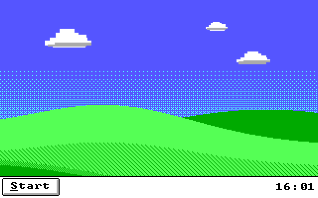
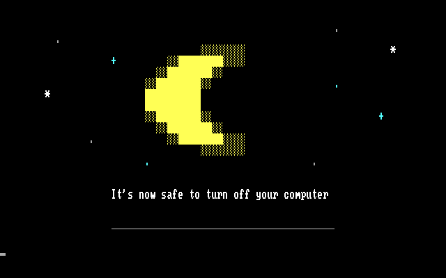
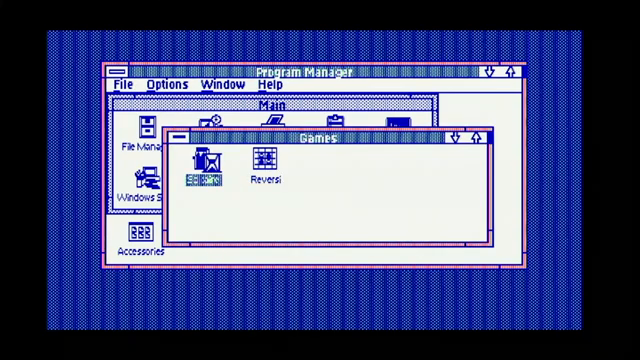
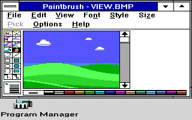
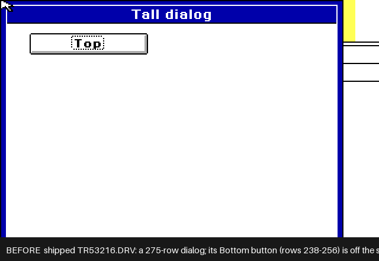
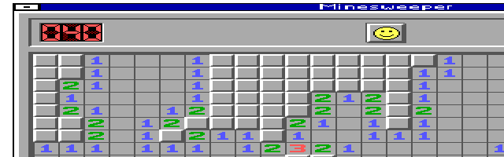
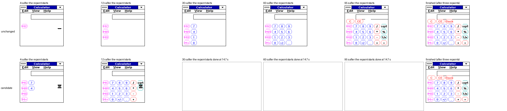
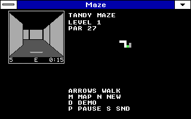

# Windows XT

**A colorful little Windows desktop for an 8088 Tandy.**

Windows XT brings color graphics, a compact Start-menu desktop, games and
utilities to Windows 3.0 on the original Tandy 1000 EX/HX.

**[Watch the Windows XT overview video](https://youtu.be/A1i9R6zSxHY)** — a look at the 16-color
Windows 3.0 desktop.

| Startup | Desktop | Shutdown |
| --- | --- | --- |
|  |  |  |

[Get started](#get-started) · [Other machines](docs/PLATFORM.MD) ·
[More screenshots and capture notes](docs/SHOWCASE.MD)

## Get started

For an **original Tandy 1000 EX/HX with normal 640 KB and Windows 3.0 real mode**:

**[Download WINXT.ZIP](https://github.com/astrobleem/oemdisplay-tandy/releases/download/windows-xt/WINXT.ZIP).**
It contains `SETUP.EXE`, `README.TXT` and an expanded `WINXT` folder.

- **Full desktop:** run `SETUP UPDATE C:\WINDOWS` or `SETUP FRESH A:\` on DOS.
  Use `C:\STARTXT` afterward.
- **Drivers only:** point Windows Setup at the same expanded `WINXT` folder,
  without running the custom installer.

Follow [installation](docs/DESKTOP.MD) for the normal Setup and launch entries.

Other hardware profiles and apps are in [current downloads](docs/DOWNLOADS.MD).
Each product has one current packet and a short install guide.

## PCjr and ColorPlus software panning

A **320x400 desktop through a 320x200, 16-color viewport** is now available
for these adapters. The kits include the helper and a fixed-mode switch-back.

**[PCjr download](https://github.com/astrobleem/oemdisplay-tandy/releases/download/windows-xt/JRPAN.ZIP)** | **[ColorPlus download](https://github.com/astrobleem/oemdisplay-tandy/releases/download/windows-xt/CPPAN.ZIP)** |
[Short install instructions](docs/SOFTPAN/RELEASE.MD) | [Windows emulator evidence](docs/SOFTPAN/README.MD)

These use software copies and 32,000 additional shadow bytes. The Windows
runs cover DOSBox-X PCjr and 86Box XT/Plantronics, each with 640 KB RAM.

## More color, compact controls

| Before: Windows 3.0, four colors | Windows XT: sixteen colors |
| --- | --- |
|  |  |

- Tandy Start: Programs, My Computer, Run/Browse and a clock.
- Original XT Pixels bitmap fonts and compact controls.
- Read existing long filenames on compatible DOS 6.22 FAT volumes.
- A DOS display-mode menu with undo and interrupted-switch recovery.
- Optional Hold-to-Start with the [compatible keyboard driver](src/tandyk3/README.md).

The display shows a **640x256 logical desktop through a 320x200, sixteen-color view**.
Keyboard panning brings off-screen windows and controls into reach.
[Display controls and installation](docs/DRIVERS.MD) ·
[Original fonts](docs/FONTS/README.MD)

For a fixed-resolution desktop, choose the [fixed profiles](docs/FIXED.MD).

## More room to play

The display packet includes panning and synchronous drawing.
The captures below retain their original, separately documented test scope.

| More room for windows | A board beyond the screen |
| --- | --- |
|  |  |

Use Ctrl+Alt+arrows to pan and Ctrl+Alt+Home to return home. XYCTL's menu or
Ctrl+Alt+H switches between software and hardware presentation.
[Install Minesweeper](https://github.com/astrobleem/oemdisplay-tandy/releases/download/windows-xt/MINESET.ZIP) ·
[Install guide](tools/CURRENT/GUIDES/MINESET.TXT) · [Capture notes](docs/pan/MINE/CAPTURE.MD).

One Calculator repaint fell from **92.5 to 10.4 seconds** in a matched emulator
experiment. That comparison has its own [drawing test scope](docs/RRECT.MD).

## Games, savers and sound

| [Maze preview](examples/MAZE/GAME/README.MD) | [Tandinator](examples/TANDINAT/README.MD) | [Tandy Winamp](https://github.com/astrobleem/oemdisplay-tandy/releases/tag/windows-xt) |
| --- | --- | --- |
|  |  |  |

Try [Pinball](examples/PINBALL/README.MD), [Cookie Clicker](examples/COOKIE/README.MD),
[Starfield](experiments/VISPART2/README.MD) and [Matrix](experiments/VISPART1/README.MD).
The [desktop bundle](docs/DESKTOP.MD) includes Maze, Pinball, Starfield and Matrix.

The separate [Tandy sound companion](https://github.com/astrobleem/oemsound-tandy)
includes Winamp's playlist player, PSG music and Tandy Beats Lab/Fiddle tools.
[Download Tandy Winamp](https://github.com/astrobleem/oemdisplay-tandy/releases/download/windows-xt/TWXT2.ZIP) ·
[App and sound details](docs/SHOWCASE.MD#apps-input-and-sound)

## Compatibility and source

Experimental software: earlier HPXY panning was accepted on a real EX; the
current XR1 package and new first-party wheel driver are emulator-qualified.
That does not certify every mode or app. Windows 3.1 is not supported.
[Hardware and capture scope](docs/SHOWCASE.MD#panning-on-real-tandy-hardware)

Other machines use [separate driver packages](docs/PLATFORM.MD), including
Video II, PC1512, PCjr, Plantronics, Yamaha and text-mode experiments.

For separate source-only DOS and portable C89 Tandy components—SN76489-family PSG state, mode-9 graphics, bounded surfaces, input and cooperative timing—see [libtandy](https://github.com/astrobleem/libtandy). This Windows display driver does not depend on that library.

The original wheel/font kit is MIT-licensed; adapted drivers and other
components retain their own [notices](tools/XR1PACK/NOTICE.TXT).
[Provenance](tools/XR1PACK/PROVENANCE.JSN) ·
[Build guide](BUILDING.MD) · [Development notes](docs/STATUS.MD) ·
[Canonical source](https://github.com/astrobleem/oemdisplay-tandy)
