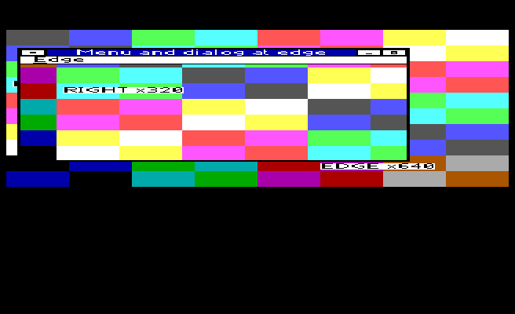
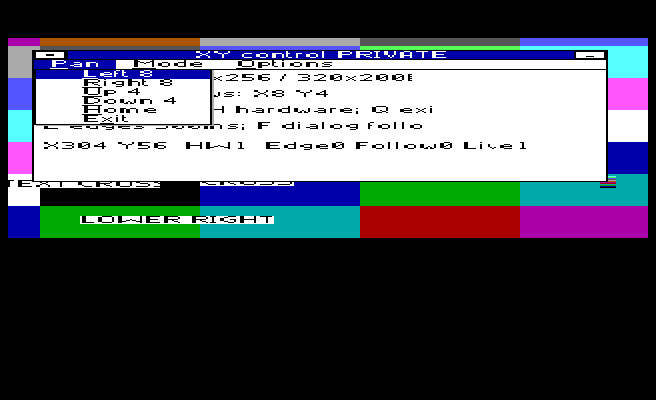
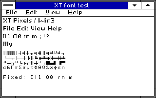
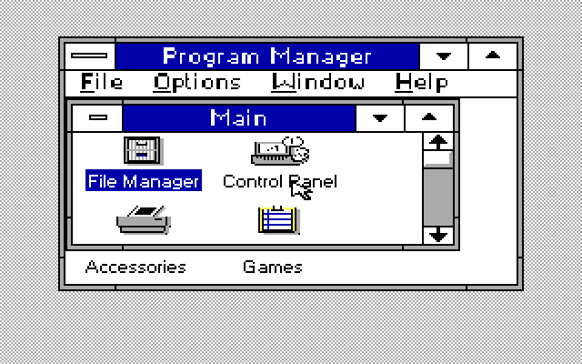

# Windows XT

**Windows 3.0 real mode for the Tandy 1000 EX/HX (640 KB).** Windows XT adds five Tandy graphics modes, original bitmap fonts and a compact Start desktop to an 8088 that would otherwise be left in CGA.

[Download 720 KB ZIP](https://github.com/astrobleem/oemdisplay-tandy/releases/download/v0.1.0-rc.6/WINXT720.ZIP) · [Disk image](https://github.com/astrobleem/oemdisplay-tandy/releases/download/v0.1.0-rc.6/WINXT720.IMG) · [Release notes and checksums](https://github.com/astrobleem/oemdisplay-tandy/releases/tag/v0.1.0-rc.6) · [Install and recover](docs/USERMAN.MD#install-windows-xt) · [User manual](docs/USERMAN.MD)

*DOSBox-X guest capture · Windows 3.0 real mode · Tandy 320×200×16 logical mode, displayed doubled. The hill wallpaper is optional and separate from RC6. [Capture provenance](docs/PROMO/SHOWCASE.MD#desktop) · [capture commit 43cf098](https://github.com/astrobleem/oemdisplay-tandy/commit/43cf0984f1d3da389231c55cdd82d8757074836a).*

## Current package: 0.1.0-rc.6 preview

Install into your own Windows 3.0 real-mode setup on a Tandy 1000 EX/HX with DOS 3.3+ and 640 KB. Windows/DOS media and the non-font support files remain user-supplied. Follow the [install, mode-change and recovery guide](docs/USERMAN.MD#install-windows-xt); after installation, start Windows with the guarded C:\WINXT\WINXT launcher.

RC6 includes the compact Tandy Start menu, Programs and Run/Browse controls, clock, original MIT-licensed bitmap fonts, guarded mode switching with undo/recovery, and support for existing long names on compatible DOS 6.22 FAT volumes. The exact release qualification and its emulator/host scope are in [RC6 qualification](docs/QUAL/RC6.MD); it is not a blanket physical-hardware certification.

| RC6 Tandy display mode | Colors |
| --- | ---: |
| 320×200 | 16 (default) |
| 640×200 | 4 |
| 160×200 | 16 |
| 320×200 | 4 |
| 640×200 | 2 |

## A desktop taller than its screen

*86Box 6.0 · Tandy 1000 HX, 8088 at 7.16 MHz · Windows 3.0 real mode · 320×200×16 viewport over a 320×400 logical desktop. Existing captured frames; the [33/33 session record](docs/pan/FIT/XPWIN.JSN) is preserved at [test commit 6d48868](https://github.com/astrobleem/oemdisplay-tandy/commit/6d48868aa62fa5b7cf5d6ed8946dd7984582ace7).*

The XTPAN prototype makes lower windows and buttons reachable without changing the 320×200 display. Keyboard pans, edge dwell, cursor rendering and mouse hit-testing were checked; one 275-row dialog's bottom button was clicked after panning. This is software viewport panning, not CRTC hardware scrolling, and it is not in RC6. A Tandy 1000 EX owner reports it works on real hardware, but no scripted physical capture, timing or memory measurement is recorded. See the [full investigation](docs/PAN.MD).

A separate Windows Minesweeper demonstration used one owner-supplied executable adapted for Windows 3.0 real mode on an 8088; panning lets a board extend below the visible 200 rows. This is an app-specific conversion, not a general x86 emulator. The executable and a verified Minesweeper screenshot are not in this public repository, so no Minesweeper download or image is shown. The panning test above verifies the driver behavior, not that app binary.

## Hardware-origin panning candidates

| HPAN R3 | HPXY R1 |
| --- | --- |
|  |  |
| 86Box Tandy 1000 HX · Windows 3 real mode · 320×200×16 display over 640×200 logical space. [Experimental ZIP](https://raw.githubusercontent.com/astrobleem/oemdisplay-tandy/main/downloads/experimental/hpan-hpxy/HPAN-R3-PHYSICAL-ACCEPTANCE.zip). Its separate owner-accepted physical record covers only a short 0→104→0 origin run; hardware qualification is false. | 86Box Tandy 1000 HX · Windows 3.0 real mode · 320×200×16 display over 640×256 logical space. [Experimental ZIP](https://raw.githubusercontent.com/astrobleem/oemdisplay-tandy/main/downloads/experimental/hpan-hpxy/HPXY-R1-EXPERIMENTAL.zip). Physical XY operation is untested. |

These are public repository-file downloads, not GitHub Release assets or installers. Read the [package guide, evidence and rollback notes](downloads/experimental/hpan-hpxy/README.md) before use. The captures above are emulator screenshots, not hardware photos.

## Same Calculator, less waiting

*86Box 6.0 · Tandy 1000 HX, 8088 at 7.16 MHz · Windows 3.0 real mode · TR5 320×200×16. This is a fixed-time screenshot sequence: the unchanged driver still lacks the Back key at 95 seconds; the candidate is complete at 14.7 seconds.*

In a separate matched timing run, one Calculator repaint fell from **92.5 to 10.4 seconds**; all 13 compared frames were byte-identical. The bounded-copy change merged in [PR #151](https://github.com/astrobleem/oemdisplay-tandy/pull/151) at [commit fc7b09b](https://github.com/astrobleem/oemdisplay-tandy/commit/fc7b09bdbe7e37dc9d562bdb746cf435b0628ba0). It is emulator-only, tested only in 320×200×16, and is not in the RC6 download. The optimized, compact and panning work is still being integrated; no combined package is released. See the [full test record](docs/RRECT.MD) and [evidence commit](https://github.com/astrobleem/oemdisplay-tandy/commit/3ece9ee38ecce27c726aa9c73c815632b28589c9).

## Readable text and compact controls

*Genuine Windows 3.0 Tandy-emulator capture · native 320×200×16 · unscaled. The capture record does not name a specific emulator model; see [screenshot provenance](docs/FONTS/SHOTS/README.TXT) and [capture commit b07a4ca](https://github.com/astrobleem/oemdisplay-tandy/commit/b07a4cad7b0e646e71402ff420d958093c2bc768).*

RC6 supplies original XT Pixels System, Fixed and OEM fonts with the inspected Windows metrics intact. At 320 pixels, text and common controls remain readable alongside Tandy Start; at 160 pixels some menus wrap and wide dialogs still clip. See the [font qualification](docs/FONTS/README.MD) and [font evidence](docs/QUAL/FONTSR10.JSON). The taller-desktop experiment above is separate work for windows that do not fit.

## Apps, input and sound

The vertical-pan test keeps cursor shape and click targets aligned as the view moves; its keyboard shortcuts and edge-dwell controls are listed in [PAN.MD](docs/PAN.MD). Small Windows apps provide more examples: [Tandy Maze](examples/MAZE/GAME/README.MD), [Tandinator](examples/TANDINAT/README.MD), [Pinball](examples/PINBALL/README.MD), [Starfield](experiments/VISPART2/README.MD) and [Matrix](experiments/VISPART1/README.MD).

*Genuine Windows 3.0 · native 320×200×16 Tandy sequencer capture. The image record does not name the emulator model or establish audio; the companion's [capture provenance](https://github.com/astrobleem/oemsound-tandy/blob/17dc29d1c2d900200084c34b3916ddf890ad3c70/docs/SHOTS/README.MD) and [DOSBox-X Tandy audio tests](https://github.com/astrobleem/oemsound-tandy/blob/17dc29d1c2d900200084c34b3916ddf890ad3c70/artifacts/win30/BEATS/VALIDATE.MD) are separate.

The [Tandy sound companion](https://github.com/astrobleem/oemsound-tandy) has public [PSGSTART](https://github.com/astrobleem/oemsound-tandy/releases/download/sound-v0.1.0-preview.20261007/PSGSTART.ZIP) and [BEATSTART](https://github.com/astrobleem/oemsound-tandy/releases/download/sound-v0.1.0-preview.20261007/BEATSTART.ZIP) packages plus a separate experimental [MML3 fifth-part Fiddle/Beats kit](https://github.com/astrobleem/oemsound-tandy/releases/download/sound-exp-v0.1.0-pit.20261007/MML3AUTH.ZIP). The baseline MIDI mapper uses the Tandy PSG's three tone channels and one noise channel; it is app-local, not a system-wide MIDI device. The experimental PIT2 fifth voice is a square-wave PC-speaker tone, not PCM. Sampled PC-speaker PWM dialogue in the separate Buddy Holly DOS demo is a different path, not Windows PCM output. Hardware audio fidelity remains unqualified.

[libwintandy](https://github.com/astrobleem/libwintandy/tree/24ff4f932c0d4d4e2a18a3c49b0ea0a8ff90e71f) publishes shared 8086 Windows 3.0 helpers and a source-inclusive [VGM/VGZ and bounded MOD format-preview package](https://github.com/astrobleem/libwintandy/blob/24ff4f932c0d4d4e2a18a3c49b0ea0a8ff90e71f/examples/FORMATS30/LibWinTandy-Win30-Formats-Gzip-Fix-Preview-20261017.zip). This is an opt-in preview, not a stable release or general-purpose emulator: VGM/VGZ accepts a defined Tandy SN76496 command subset, while MOD becomes a square-wave PSG arrangement without sampled timbres. See the [format limits and test record](https://github.com/astrobleem/libwintandy/blob/24ff4f932c0d4d4e2a18a3c49b0ea0a8ff90e71f/examples/FORMATS30/README.md).

## Other machine-specific video packages

Experimental driver and download matrix

These packages have separate install paths and qualification limits. A result for one card or computer does not qualify another.

| Target | Public download | Evidence, status and guide |
| --- | --- | --- |
| Tandy Video II, emulated SL/2 family | [TNDYV2.ZIP](https://github.com/astrobleem/oemdisplay-tandy/releases/download/experimental-video-ii-2026-10-14-r2/TNDYV2.ZIP) | Experimental; Windows rendering is for the SL/2 emulator profile only. Other SL/TL/RL models and physical hardware are unqualified. EX/HX must not use it. Run T2RESV before Setup and every Windows start; see [install/recovery](docs/tga2/INSTALL.TXT) and the [qualification](https://github.com/astrobleem/oemdisplay-tandy/releases/tag/experimental-video-ii-2026-10-14-r2). |
| Amstrad PC1512 | [PC1512.ZIP](https://github.com/astrobleem/oemdisplay-tandy/releases/download/experimental-displays-2026-10-12/PC1512.ZIP) · [front door](https://github.com/astrobleem/windows-3-amstrad-pc1512) | Experimental emulator evidence; one cursor-state case remains unresolved. [Install/recover](experiments/DISPLAY3/PC1512.TXT). |
| IBM PCjr | [PCJRSET.ZIP](https://raw.githubusercontent.com/astrobleem/oemdisplay-tandy/main/downloads/experimental/PCJR/PCJRSET.ZIP) · [front door](https://github.com/astrobleem/windows-3-pcjr) | 320×200×16 Setup packet; clean and existing-install Setup tested in DOSBox-X. This is a repository-file download, not a GitHub Release asset. [Install/recover](downloads/experimental/PCJR/README.MD). |
| IBM XT + Plantronics ColorPlus | [PCP3216.ZIP](https://github.com/astrobleem/oemdisplay-tandy/releases/download/experimental-displays-2026-10-12/PCP3216.ZIP) · [front door](https://github.com/astrobleem/windows-3-plantronics) | Experimental emulator rendering; requires the ColorPlus card and its dedicated VRAM. [Install/recover](experiments/DISPLAY3/PCP3216.TXT). |
| Olivetti Prodest PC1 / Yamaha V6355D | [PC1/B000 ZIP](https://raw.githubusercontent.com/astrobleem/oemdisplay-tandy/main/downloads/experimental/yamaha-candidate03/PC1-B000-CANDIDATE03.ZIP) · [Yamaha B800 ZIP](https://raw.githubusercontent.com/astrobleem/oemdisplay-tandy/main/downloads/experimental/yamaha-candidate03/YAMAHA-B800-CANDIDATE03.ZIP) · [front door](https://github.com/astrobleem/windows-3-olivetti-pc1) | Experimental repository files, not release assets. PC1/B000 has build and host checks only; no emulator, Setup or physical-PC1 test. The separate B800 screenshot is an 86Box IBM XT profile, not a PC1. [Corrected evidence](docs/yamaha/QUALIFICATION.MD) · [guide](experiments/YAMAHA/README.MD). |
| 80-column TEXT80 | [TEXT80.ZIP](https://raw.githubusercontent.com/astrobleem/oemdisplay-tandy/main/downloads/experimental/TEXT80/TEXT80.ZIP) · [front door](https://github.com/astrobleem/text-mode-windows) | Experimental text modes and compact C25; C25's recorded Windows binary passed 54/54 checks in 86Box XT/CGA. Other rebuilds have newer host audits, not fresh Windows GUI runs. [Install, rollback and exact scope](downloads/experimental/TEXT80/README.MD). |

### PCjr clean-install evidence

*DOSBox-X · IBM PCjr · Windows 3.0 real mode · 320×200×16. PR #138 merged at [commit 613137d](https://github.com/astrobleem/oemdisplay-tandy/commit/613137d0029817b42e141a11685182d867da911d) after 40 host tests; the [26/26 clean-install session report](docs/pcjr/INSTALL/SESSION.JSN) pins source commit [9ae4408](https://github.com/astrobleem/oemdisplay-tandy/commit/9ae44084127fe5d2f0c57ee1e1842d1ee1885573). The screenshot and PCJRSET.ZIP are repository evidence/downloads, not new release assets.*

*86Box · IBM XT (1986), 8088 at 4.77 MHz · Windows 3.0 real mode · 160×200×16 B800 profile. This proves only the pictured emulator profile, not an Olivetti PC1 or physical hardware. [Qualification and source evidence](docs/yamaha/QUALIFICATION.MD).*

[Canonical development repository](https://github.com/astrobleem/oemdisplay-tandy) · [graphics modes](docs/MODES.MD) · [user manual and recovery](docs/USERMAN.MD) · [build guide](BUILDING.MD) · [screenshot provenance](docs/PROMO/SHOWCASE.MD).