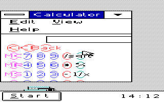
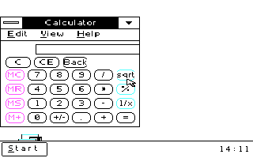
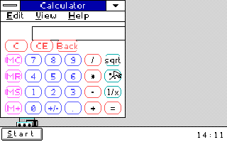
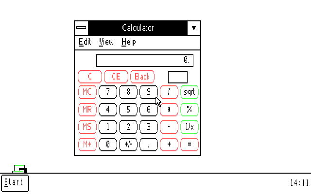
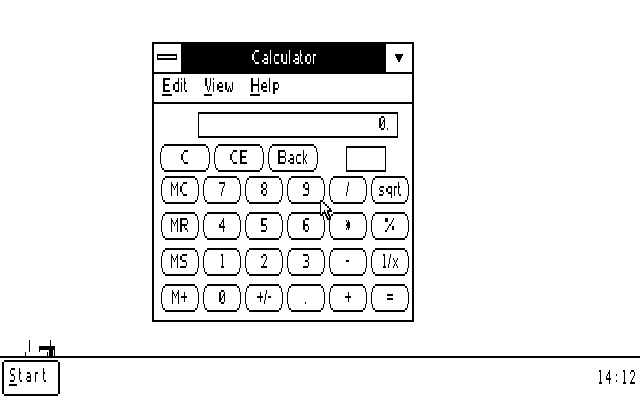
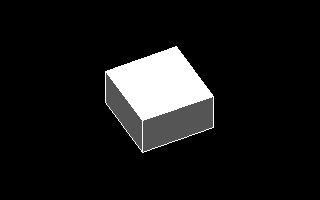
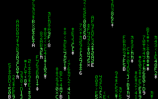

# Windows XT

**A colorful little Windows desktop for an 8088 Tandy.**

Windows XT brings color graphics, a compact Start-menu desktop, games and
utilities to Windows 3.0 real mode on the original Tandy 1000 EX/HX.

**[Watch the Windows XT overview video](https://youtu.be/A1i9R6zSxHY)**

| Startup | Desktop | Shutdown |
| --- | --- | --- |
|  |  |  |

[Get started](#get-started) · [Other machines](#other-machines) ·
[All downloads](docs/DOWNLOADS.MD) · [Screenshots](docs/SHOWCASE.MD)

## Get started

**[Download WXTF1107.ZIP](https://github.com/astrobleem/oemdisplay-tandy/releases/download/windows-xt/WXTF1107.ZIP)**

This pack is for an **original Tandy 1000 EX/HX with 640 KB RAM and Windows
3.0 in real mode**. It does not include DOS or Windows. The drivers and apps
are ready to install.

Extract the ZIP with folders intact, for example into `C:\INSTALL`. Keep
`SETUP.EXE`, `README.TXT` and the expanded `WINXT` folder together. Back up
an existing Windows installation before changing its drivers.

### Display drivers only

Choose this if you want the Tandy graphics modes while keeping your current
desktop, keyboard, mouse and sound setup. You need **installed Windows 3.0
real mode, its Windows Setup files, and DOS 3.20 or later**. Read the
[illustrated installation guide](docs/DRIVERS.MD) before updating existing drivers.

1. Exit Windows. From the extracted `WINXT` folder, run `DISPLAY`.
2. In Windows Setup choose **Display > Other**, enter that folder's full path
   (for example `C:\INSTALL\WINXT`) and select **Tandy EX/HX 320x200 16 colors
   (no panning)** for a full-screen, sixteen-color desktop. Choose **Complete
   Changes** and supply the same folder if Setup asks for the driver disk.
3. For every Windows session, run `DISPWIN` from that same folder.

Windows in another directory is supported by this route, for example
`DISPLAY D: \WIN30` and `DISPWIN D: \WIN30`.

### Full Windows XT desktop

Choose this for Tandy Start, bundled apps, screen savers, fonts and startup
artwork. You need **DOS 3.3 or later**, supported **English Windows 3.0**
files and a writable C: drive. Start with the [full installation guide](docs/DESKTOP.MD).

Full Setup replaces Windows' keyboard, mouse and sound drivers. Its mouse
support is currently **COM1 serial only**. Choose display drivers only to
keep your current input setup.

- **Existing Windows in C:\WINDOWS:** select the Tandy display using the
  steps above, then run `SETUP UPDATE C:\WINDOWS` from the folder containing
  `SETUP.EXE`. UPDATE keeps your selected display, so choose sixteen colors
  first if you want them.
- **No Windows installation yet:** follow the [fresh-install instructions](docs/DESKTOP.MD#if-windows-is-not-installed-yet)
  using your original Windows disks. A complete fresh installation is not yet verified.
- After installation, use **`C:\STARTXT`** for every session.

Use the launcher for your installation choice. If it reports an error,
resolve that error rather than starting Windows directly.

### Choose your screen layout

Select a mode through **Display > Other** in Windows Setup. These emulator
previews show Calculator in each fixed mode; click an image for the full view.

| Resolution | Colors | Preview |
| --- | --- | --- |
| 160x200 | 16 |  |
| 320x200 | 4 |  |
| **320x200** | **16, recommended** |  |
| 640x200 | 4 |  |
| 640x200 | Monochrome |  |

The 160-pixel mode is cramped for standard Windows apps; many dialogs do not fit.

For more room than fits on screen, choose **Tandy EX/HX HPXY 640x256 hardware
pan** in that same list. This gives you a 640x256 desktop viewed through a
320x200 window; you scroll the view to reach the rest.
[Panning controls](#panning-controls) are described below.

## What's included

| Before: Windows 3.0, four colors | Windows XT: sixteen colors |
| --- | --- |
|  |  |

- **Tandy Start:** existing Program Manager groups, My Computer, Run/Browse,
  a clock and screen-saver settings.
- **Faster drawing:** Calculator redraws in about a second in the default
  display mode in our [emulator test](https://github.com/astrobleem/oemdisplay-tandy/pull/218).
- **Keyboard and mouse shortcuts:** open Start with the Hold key on
  supported Tandy systems, and use a compatible serial mouse's wheel to
  scroll supported Windows controls. These features come with the full
  desktop. [Keyboard and mouse guide](docs/USERMAN.MD#keyboard-mouse-and-joystick).
- **DOS clipboard:** Shift+Print copies DOS text or graphics into Windows.
  [Supported modes and palette limits](docs/GRABBER.MD).
- **Long-name browsing:** see existing long filenames in Run/Browse on
  supported DOS 6.22 disks. Other programs still use their DOS short names.
  [Requirements](docs/USERMAN.MD#browse-existing-long-filenames).
- **Pinball, four screen savers, original bitmap fonts, startup and shutdown
  artwork**.

## Panning controls

**PAN** lets you move around a desktop larger than your screen. It is
included in the Windows XT, CGA, PCjr and ColorPlus downloads. The separate
**[PAN.ZIP](https://github.com/astrobleem/oemdisplay-tandy/releases/download/windows-xt/PAN.ZIP)**
updates an existing supported display installation.

- **Tandy HPXY:** a 640x256 desktop through a 320x200, sixteen-color view,
  with a choice of Software or Hardware scrolling.
- **PCjr and ColorPlus:** a 640x400 software desktop through a 320x200,
  sixteen-color view, panning on both axes. Fixed 320x200 is also available.
- **CGA 160x100:** a 320x200 desktop through a 160x100 view.
- **Supported fixed displays:** an optional larger workspace that moves
  windows in and out of view.

In Windows, run **`PAN /SETTINGS`** to get started. While panning is running,
**Ctrl+Alt+S** opens settings, **Ctrl+Alt+arrows** move, **Ctrl+Alt+Home**
returns home and **Ctrl+Alt+End** brings the active window into view.
`PAN OFF` disables panning; `PAN` enables it again.
[Installation, controls and memory requirements](docs/PANNING.MD).

## Optional fonts

The fonts needed by each display mode are installed automatically.

For applications, the pack includes six optional **XT Tandy** fonts and three
compact **Helv** fonts. Add the ones you want through **Control Panel > Fonts
> Add**, from `C:\WINXT\FONTS` after full Setup or the extracted
`WINXT\FONTS` folder with drivers only. Leave Helv unselected if you want to
keep your existing Helv choices. [Font guide](docs/FONTS/README.MD).

## Screen savers

Choose **Cube, Starfield, Matrix or Ovals** in **System > Screen saver**.
Adjust the idle delay there, too. [Cube](docs/CUBE.MD) offers Flat, Dither
and Wire styles. Ovals cycles through five animated scenes.

| Cube | Starfield |
| --- | --- |
|  |  |

| Matrix | Ovals |
| --- | --- |
|  |  |

## Games and sound

[Pinball](examples/PINBALL/README.MD) comes with the desktop. Add
[Cookie Clicker](https://github.com/astrobleem/oemdisplay-tandy/releases/download/windows-xt/COOKSET.ZIP),
[converted Minesweeper](tools/CURRENT/GUIDES/MINESET.TXT) or the
[TANDYLAB app collection](examples/TANDYLAB/README.MD) separately.
The [green hill wallpaper](examples/HILLS/README.TXT) shown above is optional.

The separate [Tandy sound companion](https://github.com/astrobleem/oemsound-tandy)
provides **Tandy Winamp**, PSG music and **Tandy Beats Lab/Fiddle** tools.
[App and sound downloads](docs/DOWNLOADS.MD).

## Other machines

Choose the download for your adapter:

- **IBM CGA RGBI:** fixed/panning 160x100 in sixteen colors, standard or compact
  320x200 four-color and 640x200 monochrome. The kit also supports fresh Windows
  Setup with its 640x200 driver. [CGA installation](docs/CGA.MD).
- **IBM PCjr and Plantronics ColorPlus:** fixed or two-axis software-panning
  desktops. [Install guide](docs/SOFTPAN/RELEASE.MD).
- **Tandy SL/2 Video II:** 640x200 in sixteen colors.
  [Installation](docs/tga2/INSTALL.TXT).
- **Amstrad PC1512, Olivetti PC1, standalone Yamaha and text-mode profiles:**
  [hardware choices and limits](docs/PLATFORM.MD).

[All hardware downloads](docs/DOWNLOADS.MD).

## Compatibility and source

Windows XT is experimental and supports **Windows 3.0 real mode, not Windows
3.1**. Testing has mainly used emulators; check your hardware's guide for
known limits. Some standard Windows dialogs do not fit on narrow displays.
[Current release and downloads](https://github.com/astrobleem/oemdisplay-tandy/releases/tag/windows-xt).

The original wheel/font kit is MIT-licensed; adapted drivers and other
components retain their own [notices](tools/XR1PACK/NOTICE.TXT).
[Build guide](BUILDING.MD) ·
[Source code](https://github.com/astrobleem/oemdisplay-tandy).
