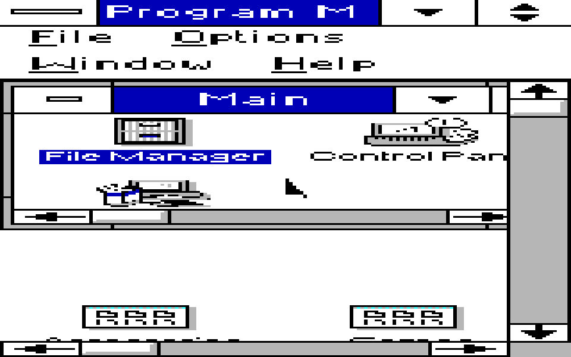
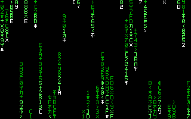

# Windows XT

Windows XT brings color graphics, a compact Start-menu desktop, games and

utilities to Windows 3.0 on the Tandy 1000 EX/HX.

| Startup | Desktop | Shutdown |
| --- | --- | --- |
|  |  |  |

[User manual](docs/USERMAN.MD) · [Downloads and installation](#get-started)

## Before and Windows XT

| Before: Windows 3.0, four colors | Windows XT: sixteen colors |
| --- | --- |
|  |  |

From [Chad's earlier video](https://www.youtube.com/watch?v=yNisFBDLXos&t=1230s).

Paintbrush in 320x200, with all 16 palette colors. Different modes; appearance comparison. [Capture details](docs/PROMO/SHOWCASE.MD#earlier-windows-30-video).

## Features

- Five graphics modes, including 320x200 in 16 colors.

- Tandy Start: Programs, My Computer, Run/Browse and a clock.

- Long filename browsing for existing names on supported DOS 6.22 FAT volumes.

- Games, screen savers, green hill wallpaper and optional

  [Tandy sound](https://github.com/astrobleem/oemsound-tandy).

- Original MIT-licensed bitmap fonts and static logo.

- DOS display-mode menu with undo and interrupted-switch recovery.

- Faster guarded startup and normal installation with zero SHA verification.

- Short animated startup and a moon-and-stars shutdown screen.

Experimental software. Requires your own Windows 3.0 installation, DOS 3.3+

and a supported Tandy 1000 EX/HX with 640 KB RAM.

## Apps

| [Buddy Holly · Tandy sound](https://github.com/astrobleem/oemsound-tandy) | [Maze preview](examples/MAZE/GAME/README.MD) | [Tandinator](examples/TANDINAT/README.MD) |
| --- | --- | --- |
|  |  |  |

Buddy Holly is a silent GIF; click it for the sound companion.

Maze is a separate preview; the disk image includes the older saver.

[Pinball](examples/PINBALL/README.MD), [Cookie Clicker](examples/COOKIE/README.MD)

and more are in the user manual.

[Capture details](docs/PROMO/SHOWCASE.MD).

## Get started

**[Download Windows XT 0.1.0-rc.6](https://github.com/astrobleem/oemdisplay-tandy/releases/tag/v0.1.0-rc.6)**

— [720 KB disk ZIP](https://github.com/astrobleem/oemdisplay-tandy/releases/download/v0.1.0-rc.6/WINXT720.ZIP)

or [disk image](https://github.com/astrobleem/oemdisplay-tandy/releases/download/v0.1.0-rc.6/WINXT720.IMG).

Back up Windows, then follow the [installation guide](tools/FLASHDISK/README.MD).

Use the guarded `C:\WINXT\WINXT` launcher after installation.

The [short animated startup](examples/WXTSPL/WAVE/README.MD) is enabled by

the guarded installer in Color mode; other modes retain static startup.

The [original fonts](docs/FONTS/README.MD) are included. Windows and the CGA.GR2

non-font support file still come from your own installation/media.

[Optional experimental downloads](https://github.com/astrobleem/oemdisplay-tandy/releases/tag/experiments-2026-10-07)

have their own installation guides.

## Other video hardware: experimental drivers

These are separate experimental Windows 3.0 drivers. Back up the complete

installation and follow the machine's installation and recovery guide. Physical

hardware remains unqualified. The new PCjr packet supports clean Windows Setup

and changing an existing installation, both checked in DOSBox-X.

| Machine/card | Mode and download | Status and guide |
| --- | --- | --- |
| [Amstrad PC1512](https://github.com/astrobleem/windows-3-amstrad-pc1512) | [PC1512.DRV, 640x200x16](https://github.com/astrobleem/oemdisplay-tandy/releases/download/experimental-displays-2026-10-12/PC1512.ZIP) | Emulator rendering evidence; one cursor-state case remains unresolved. [Install/recover](experiments/DISPLAY3/PC1512.TXT) |
| [IBM PCjr](https://github.com/astrobleem/windows-3-pcjr) | [PCJRSET.ZIP: clean Setup packet, 320x200x16](https://raw.githubusercontent.com/astrobleem/oemdisplay-tandy/main/downloads/experimental/PCJR/PCJRSET.ZIP) | Original fonts, static logo and PCjr-safe grabber included; guard required before Setup and every start. [Install/recover](downloads/experimental/PCJR/README.MD) |
| [IBM XT + Plantronics ColorPlus](https://github.com/astrobleem/windows-3-plantronics) | [PCP3216.DRV, 320x200x16](https://github.com/astrobleem/oemdisplay-tandy/releases/download/experimental-displays-2026-10-12/PCP3216.ZIP) | Emulator rendering evidence; requires the ColorPlus card and its dedicated VRAM. [Install/recover](experiments/DISPLAY3/PCP3216.TXT) |
| [Olivetti Prodest PC1 / Yamaha V6355D](https://github.com/astrobleem/windows-3-olivetti-pc1) | [PC1/B000 ZIP](https://raw.githubusercontent.com/astrobleem/oemdisplay-tandy/main/downloads/experimental/yamaha-candidate03/PC1-B000-CANDIDATE03.ZIP) · [B800 ZIP](https://raw.githubusercontent.com/astrobleem/oemdisplay-tandy/main/downloads/experimental/yamaha-candidate03/YAMAHA-B800-CANDIDATE03.ZIP) · [source/evidence](https://raw.githubusercontent.com/astrobleem/oemdisplay-tandy/main/downloads/experimental/yamaha-candidate03/YAMAHA-CANDIDATE03-SOURCE-EVIDENCE.ZIP) | Experimental repository-file downloads, not release assets. PC1/B000 has build/host checks only; no emulator, Setup, or physical PC1 test. [Evidence](docs/yamaha/QUALIFICATION.MD) · [guide](experiments/YAMAHA/README.MD) |

Original B800 emulator capture. Source-built [86Box commit ceb009f](https://github.com/86Box/86Box/commit/ceb009f17daeecbb81e1ddf26ad63beda9300afe), IBM XT (1986), 8088 at 4.77 MHz, 640 KB, Windows 3.0 real mode. This is emulator evidence for the B800 profile, not a PC1 screenshot or hardware qualification. The 92-case raw-VRAM/API suite is separate DOSBox-X evidence; it does not emulate Yamaha scanout. See the [corrected test record](docs/yamaha/QUALIFICATION.MD). The Yamaha driver and source/evidence ZIPs are repository-file downloads, not release assets; existing release tags and pinned Windows XT payloads are unchanged.

[Experimental release, source and checksums](https://github.com/astrobleem/oemdisplay-tandy/releases/tag/experimental-displays-2026-10-12)

and [qualification scope](experiments/DISPLAY3/README.MD). Tandy EX/HX users

should continue with Windows XT rc.6 above. The older 2026-10-12 release

remains unchanged. The new PCjr Setup packet includes original XT Pixels fonts

and a DDK-derived PCjr grabber; no Windows/DOS media or Microsoft fonts ship. PCJRSET.ZIP is a repository-file download, not an asset in the 2026-10-12 release.

PCjr [PR #138](https://github.com/astrobleem/oemdisplay-tandy/pull/138) merged at [613137d](https://github.com/astrobleem/oemdisplay-tandy/commit/613137d0029817b42e141a11685182d867da911d) after 40 host tests. The clean-install session records test source commit [9ae4408](https://github.com/astrobleem/oemdisplay-tandy/commit/9ae44084127fe5d2f0c57ee1e1842d1ee1885573). It adds a clean-install [screenshot](https://github.com/astrobleem/oemdisplay-tandy/blob/613137d0029817b42e141a11685182d867da911d/docs/pcjr/INSTALL/DESKTOP.PNG) and [26/26 session record](https://github.com/astrobleem/oemdisplay-tandy/blob/613137d0029817b42e141a11685182d867da911d/docs/pcjr/INSTALL/SESSION.JSN); both [post-merge install checks](https://github.com/astrobleem/oemdisplay-tandy/actions/runs/39078997906) and [disk build](https://github.com/astrobleem/oemdisplay-tandy/actions/runs/39078997999) passed. The new [PCJRSET.ZIP](downloads/experimental/PCJR/README.MD) publishes that clean-install folder separately; the old PCJR.ZIP stays unchanged.

## Display modes

| Resolution | Colors |
| --- | ---: |
| **320x200** | **16 — default** |
| 640x200 | 2 |
| 640x200 | 4 |
| 320x200 | 4 |
| 160x200 | 16 |

**Tandy Video II 640x200x16: experimental SL/2 family only ([front door](https://github.com/astrobleem/windows-3-tandy-video-ii)).**

[Download TNDYV2.ZIP](https://github.com/astrobleem/oemdisplay-tandy/releases/download/experimental-video-ii-2026-10-14-r2/TNDYV2.ZIP)

and read the [release notes and qualification](https://github.com/astrobleem/oemdisplay-tandy/releases/tag/experimental-video-ii-2026-10-14-r2)

and [Setup, owned-file staging and recovery guide](docs/tga2/INSTALL.TXT).

Windows rendering evidence covers the emulated SL/2 only. Physical hardware,

other SL/TL/RL models remain unqualified; EX/HX must not use

this driver. Run T2RESV successfully before Setup and every Windows start.

**[Download TEXT80 / compact C25](https://raw.githubusercontent.com/astrobleem/oemdisplay-tandy/main/downloads/experimental/TEXT80/TEXT80.ZIP)**

for experimental 80-column text Windows 3.0, including PAN and VGA variants.

[Installation, rollback and exact test scope](downloads/experimental/TEXT80/README.MD)

and [rendering details](docs/TEXT80.MD) ([front door](https://github.com/astrobleem/text-mode-windows)).

C25 matches its recorded Windows-tested binary (54/54 in 86Box XT/CGA).

The other current rebuilds have fresh audits/presenter checks; their earlier

Windows GUI sessions used different binary hashes. The older rc.6 TXTMODE

feasibility driver is historical.

Yamaha Candidate 03 packages are experimental repository files, separate from the

2026-10-12 GitHub release. The B800 86Box screenshot is distinct from the 92-case

DOSBox-X raw-VRAM/API suite, which does not emulate Yamaha scanout. PC1/B000 has

build/host checks only; no emulator, Setup, or physical PC1 test. Read the [Olivetti

front door](https://github.com/astrobleem/windows-3-olivetti-pc1), [download guide]

(experiments/YAMAHA/README.MD), and [corrected evidence record]

(docs/yamaha/QUALIFICATION.MD).

HPAN R3 and HPXY R1 are experimental repository-file downloads, not GitHub Release assets:

[HPAN R3 ZIP](https://raw.githubusercontent.com/astrobleem/oemdisplay-tandy/main/downloads/experimental/hpan-hpxy/HPAN-R3-PHYSICAL-ACCEPTANCE.zip) ·

[HPXY R1 ZIP](https://raw.githubusercontent.com/astrobleem/oemdisplay-tandy/main/downloads/experimental/hpan-hpxy/HPXY-R1-EXPERIMENTAL.zip) ·

[package guide and original emulator captures](downloads/experimental/hpan-hpxy/README.md).

HPAN R3 separates its 86Box run from a `USER_ACCEPTED_PARTIAL` physical run and marks hardware

qualification false. HPXY R1 has emulator evidence only; physical XY operation is untested.

The HPXY ZIP includes the nine first-party HPAN source files required by `XYPATCH.PY`.

For mode details, the text-mode experiment, app guides, long filename

requirements and recovery, see the [user manual](docs/USERMAN.MD).

[Development status](docs/STATUS.MD) · [Build guide](BUILDING.MD)

## Screen savers

| [Starfield](experiments/VISPART2/README.MD) | [Matrix](experiments/VISPART1/README.MD) |
| --- | --- |
|  |  |

