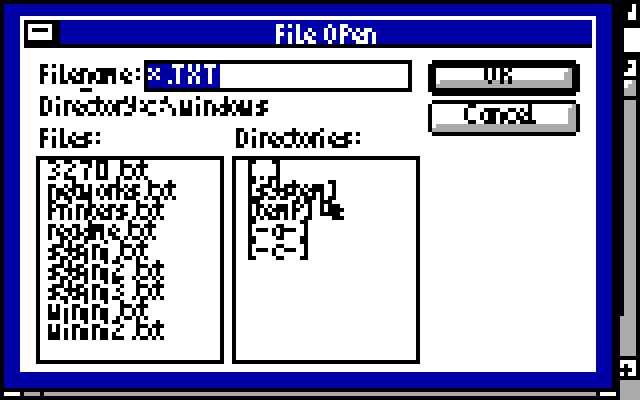

# CGA graphics for Windows 3.0

**[Download CGA.ZIP](https://github.com/astrobleem/oemdisplay-tandy/releases/download/windows-xt/CGA.ZIP)**

Windows on IBM CGA, including **160x100 with 16 colors**, compact fonts and
small controls. You need installed Windows 3.0 real mode, DOS 3.3+ and 640 KB.

[](CGA/PAINT100.PNG)

*Windows 3.0 Paintbrush at 160x100, enlarged 4x. The picture itself uses all
16 RGBI colors, verified pixel for pixel against the opened BMP.
[Original 160x100 image](CGA/PAINT100.PNG) · [Palette view](CGA/PAINTPLX.PNG) ·
[Try the picture](CGA/COVE16.BMP).
Captured from native IBM XT/CGA emulation; not a real-hardware photograph.*

## 1. Extract the download

Keep root `SETUP.EXE`, `README.TXT` and the expanded `CGA` folder together.
This is a drivers-only packet for existing Windows; fonts and support files
are included. Use its root SETUP to install the compact dialog fonts too.

## 2. Choose a mode

Exit Windows. From the extracted folder in DOS, run:

```bat
SETUP C:\WINDOWS 100
```

Use your actual Windows path. Replace `100` to choose another mode:

| Choice | Resolution and colors |
| --- | --- |
| `100` | 160x100, 16 RGBI colors, smallest fonts and controls |
| `320` | 320x200, black / bright cyan / magenta / white |
| `640` | 640x200, black and white |

Wait for Setup's success message; a 4.77 MHz 8088 takes several minutes.

## 3. Start Windows

Change to your Windows directory and run `WIN /R`.

[](CGA/OPEN100.PNG)

*Notepad File Open at 160x100, enlarged 4x.
[Original image](CGA/OPEN100.PNG).*

At 160x100, **Ctrl+Alt+arrows** moves the window workspace;
**Ctrl+Alt+Home** returns home and **Ctrl+Alt+End** exposes the active window's
bottom/right. File Manager's maximize and File Open commands help on this
short screen. Extended characters currently use fallback boxes.

[](CGA/FILE100.PNG)

*File Manager at 160x100, enlarged 4x; this frame uses five colors.
[Original image](CGA/FILE100.PNG).*

## Other modes and undo

Exit Windows and rerun SETUP with `320` or `640` to change mode. To undo:

```bat
SETUP UNDO C:\WINDOWS
```

| 320x200, four colors | 640x200, monochrome |
| --- | --- |
| [](CGA/OPEN320.PNG) | [](CGA/OPEN640.PNG) |

*[Original 320x200 image](CGA/OPEN320.PNG) ·
[Original 640x200 image](CGA/OPEN640.PNG). The 320 frame uses three of its
four available colors; the 640 frame uses both.*

These modes were tested in IBM CGA emulation. Physical cards, clone CRTCs,
composite, PCjr/Tandy and EGA/VGA remain separate targets.
[Image sources and capture details](CGA/CAPTURES.MD) ·
[Text instructions and recovery](../downloads/experimental/CGA/README.TXT).
