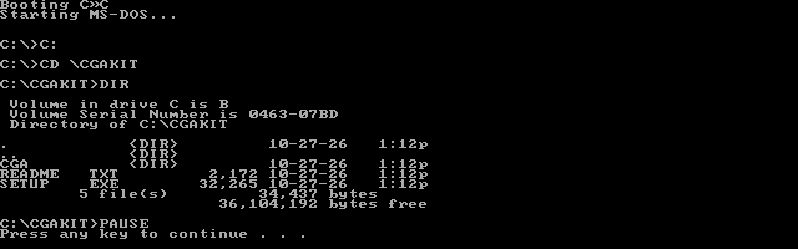
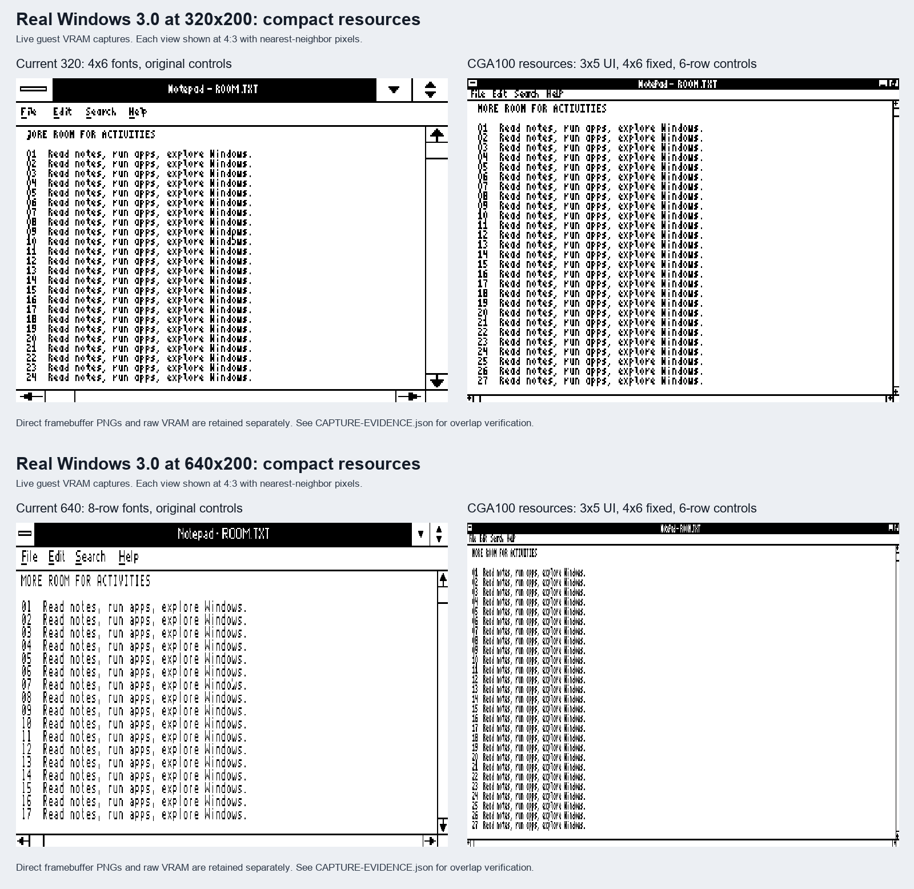
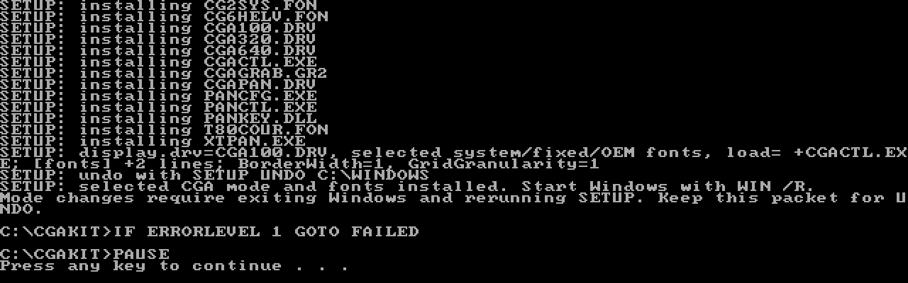
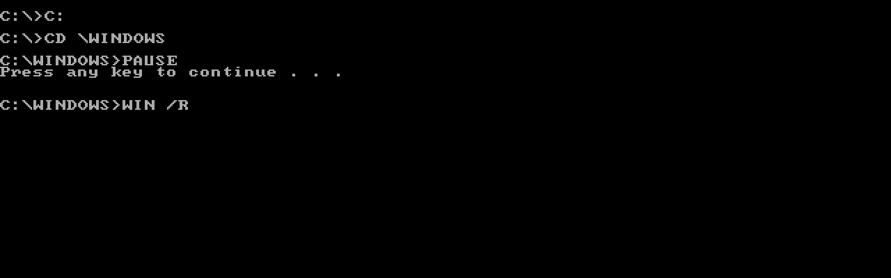
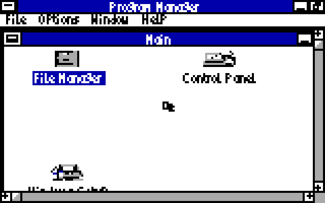

# Install the CGA driver for Windows 3.0

**[Download CGA.ZIP](https://github.com/astrobleem/oemdisplay-tandy/releases/download/windows-xt/CGA.ZIP)**

This supplies the CGA display driver, matching fonts, grabber and helpers for
**fresh or existing Windows 3.0 installations**. You need **DOS 3.3 or later, 640 KB RAM,
Windows 3.0 real mode, and IBM CGA with RGBI output**. Windows and DOS are not
included; Windows 3.1 is unsupported. Fresh Setup starts with the project's
fixed 640x200 monochrome profile. The mode choices below remain available
after Windows is installed.

The examples use **`C:\WINDOWS`** for Windows and **`C:\CGAKIT`** for the extracted
download. Substitute your actual drives and directories.

## Fresh Windows installation

Extract this download on the DOS computer with folders preserved, as shown
below. At plain DOS, insert your first original English retail Windows 3.0
Setup disk and run:

```bat
C:
CD \CGAKIT
FRESH A:\
```

For unchanged original Windows media already collected in one directory, use
`FRESH C:\W30SRC`. The native launcher prints the exact display-driver path.
In original Windows Setup choose **Display**, scroll down to **Other**, enter
that `FRESH640` path, and select **Windows XT IBM CGA 640x200 mono**. Accept the
hardware list and complete Setup. Give the same path when it asks for our
display disk; supply your original Windows disks for Microsoft file requests.
Start the installed Windows with `WIN /R`.

The driver, matching fonts and grabber are used during graphical Setup. No
Python, modern-host conversion, manual INI edits or separate support gathering
is needed. Fresh Setup currently offers this one fixed profile. To choose
another resolution afterward, exit Windows and run the normal `SETUP C:\WINDOWS`
menu below. The original existing-Windows instructions are also retained as
`CGAOLD.TXT` in the archive.

[Fresh Setup scope and native evidence](CGA-FRESH.MD) record the exact media,
640 KB IBM XT/CGA fixture and physical-hardware limits. Other Setup versions
are refused. Developer launcher rebuild inputs are in
[CGASRC.ZIP](https://github.com/astrobleem/oemdisplay-tandy/releases/download/windows-xt/CGASRC.ZIP).

## 1. Exit Windows and extract the package

If Windows is running, use Program Manager's **File → Exit Windows** and
confirm the exit. Run the following commands at the plain DOS prompt.

Transfer `CGA.ZIP` to the DOS computer using your usual floppy, disk or network
transfer. Use a DOS ZIP extractor that preserves folders. For example, with
PKUNZIP available and the archive on `A:`:

```bat
C:
MD \CGAKIT
CD \CGAKIT
PKUNZIP -D A:\CGA.ZIP
DIR
DIR CGA
```

You should now have this layout:

```text
C:\CGAKIT\SETUP.EXE
C:\CGAKIT\README.TXT
C:\CGAKIT\CGA\CGA100.DRV
C:\CGAKIT\CGA\CGAPAN.DRV
C:\CGAKIT\CGA\...the other supplied files...
```

Keep the complete `CGA` folder beside the package's root `SETUP.EXE`.
You do not need Python, a modern-PC preparation step or separately collected
fonts and support files.

[](CGA/INSTALL/FILES.PNG)

*The extracted package in `C:\CGAKIT`, captured from the DOS guest.*

## 2. Choose a mode

Run `SETUP C:\WINDOWS` to choose from a menu, or use one direct command
from this table. Standard and compact text sizes are listed side by side.
Press Enter at the menu to cancel without changes. `PAN` gives applications
such as Paintbrush a larger desktop through a movable view.

| Run from `C:\CGAKIT` | Result |
| --- | --- |
| `SETUP C:\WINDOWS 100` | Fixed 160×100 desktop, 16 RGBI colors, compact fonts and controls |
| `SETUP C:\WINDOWS PAN` | 320×200 desktop in 16 colors, seen through a movable 160×100 view |
| `SETUP C:\WINDOWS 320` | Standard UI; fixed 320×200: black, bright cyan, magenta and white |
| `SETUP C:\WINDOWS 320C` | Same four colors; compact UI and controls, 4×6 fixed text |
| `SETUP C:\WINDOWS 640` | Standard UI; fixed 640×200: black and white |
| `SETUP C:\WINDOWS 640C` | Same monochrome resolution; compact UI and controls, 4×6 fixed text |

The compact choices use 3×5 UI text and six-row controls to leave more
room. Standard choices keep larger UI text. Let your eyes decide: `320` and
`640` retain their existing defaults, and dropping the `C` restores that
resolution's standard fonts and controls. Both styles include their fonts.

[](CGA/COMPACT.PNG)

*Actual Windows 3.0 emulation captures of both styles, displayed at 4:3 with
nearest-neighbor pixels. The compact views use the real smaller fonts and
OEM resources; only the presentation of the captures is enlarged.*

## 3. Install the selected driver

For the fixed 160×100 desktop, type:

```bat
C:
CD \CGAKIT
SETUP C:\WINDOWS 100
```

Use the `SETUP.EXE` supplied in this download. It copies the driver and support
files and selects them in the Windows configuration automatically. There is
no separate Windows Setup selection or manual INI edit for this route.

Wait for checking and copying to finish; a 4.77 MHz 8088 takes several minutes.
Continue only after the installer reports:

```text
SETUP: selected CGA mode and fonts installed. Start Windows with WIN /R.
```

If it reports an error, stop and use the checks below before starting Windows.

[](CGA/INSTALL/SETUP.PNG)

*Successful installation of mode `100`. Your chosen mode appears in the
`display.drv` line.*

## 4. Start Windows in real mode

Change to the Windows drive and directory, then launch Windows:

```bat
C:
CD \WINDOWS
WIN /R
```

Use those same launch commands for later sessions. A new installation starts
PAN automatically. A previous OFF choice is preserved; run `PAN` inside Windows
to enable it again.

[](CGA/INSTALL/START.PNG)

*Starting Windows in real mode. `PAUSE` and the error-level check visible in
these captures belong to the recording harness; you do not need to type them.*



*Program Manager at 160×100, enlarged 4× from an existing Windows emulator
capture. This illustrates the installed display; capture provenance is in
[CGA image sources](CGA/CAPTURES.MD).*

## 5. Reach windows and controls

- In `PAN`, **Ctrl+Alt+arrows** moves the viewport over the larger desktop.
  **Ctrl+Alt+Home** returns to the top left; **Ctrl+Alt+End** shows the active
  window's bottom/right. Edge scrolling and window following are available.
- In fixed `100`, those commands move windows and active client contents to
  expose hidden controls; the framebuffer remains 160×100.
- **Ctrl+Alt+S**, or `PAN /SETTINGS` from Windows Run, opens the matching
  settings. Apply saves changes; Cancel discards unapplied edits.

See [Panning settings and controls](PANNING.MD). Fixed `320` and `640` can opt
into a window workspace through `PAN`. Compact 160×100 fonts currently
show fallback boxes for extended characters.

## Change mode or undo

Exit Windows, return to `C:\CGAKIT`, and rerun the chosen Setup command with
`100`, `PAN`, `320`, `320C`, `640` or `640C`. To remove this packet's changes:

```bat
C:
CD \CGAKIT
SETUP UNDO C:\WINDOWS
```

Keep the package for mode changes and undo. `UNDO` preserves unrelated later
INI edits. The separate `RESTORE` recovery command replaces whole saved INIs
and loses later edits; use the included `README.TXT` for that recovery path.

## If Setup stops

| Message or symptom | What to check |
| --- | --- |
| `Exit Windows completely before running SETUP` | Exit Windows itself, including any Windows DOS session, then retry from plain DOS. |
| `Existing Windows directory and SYSTEM folder required` | Use the directory containing your installed `WIN.COM` and `SYSTEM` folder. |
| Missing or damaged packet file | Re-extract the complete ZIP with directories preserved; keep `CGA` beside root `SETUP.EXE`. |
| Different, changed or incomplete installed files | Keep the recovery files and follow the package's `README.TXT`; do not delete the journals or overwrite individual drivers. |

The [current text instructions](../tools/PAN/GUIDES/CGA.TXT) match the package.
Testing uses IBM XT/CGA emulation with normal 640 KB; physical cards, clone
CRTCs and composite output remain unqualified. PCjr, Tandy and EGA/VGA are
separate targets.

The DOS screenshots use the preceding public package. The current download
retains the same layout and success message and adds the optional compact choices; file sizes and
helper-copy lines differ. The current settings entry is `PAN /SETTINGS`.
[Original captures and exact version scope](CGA/INSTALL/CAPTURES.MD).

[Sixteen-color Paintbrush and capture details](CGA/CAPTURES.MD) ·
[Current release and checksums](https://github.com/astrobleem/oemdisplay-tandy/releases/tag/windows-xt) ·
[CGA front door](https://github.com/astrobleem/windows-3-cga)
