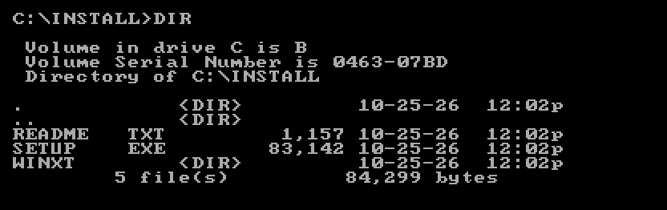
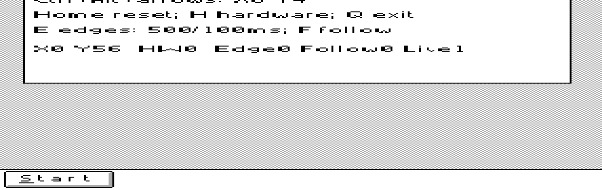

# Windows XT

[Download WINXT.ZIP](https://github.com/astrobleem/oemdisplay-tandy/releases/download/windows-xt/WINXT.ZIP).
The target is an original Tandy 1000 EX/HX with normal 640 KB and Windows 3.0
real mode. Original Windows and DOS are required. Installation runs on the
DOS computer itself; the full installer requires DOS 3.3 or later.

## 1. Extract the download

Extract `WINXT.ZIP` on the DOS computer. Keep `SETUP.EXE`, `README.TXT` and
the expanded `WINXT` folder together. The folder contains the actual drivers,
apps, fonts, grabber and logos; the ZIP is no longer needed.



*This example uses `C:\INSTALL`. Your extraction folder can have another name.*

## 2. Choose the full installation

Exit Windows. At the DOS prompt, change to the folder containing `SETUP.EXE`.
For an existing Windows installation in `C:\WINDOWS`, run:

```bat
SETUP UPDATE C:\WINDOWS
```


*Press Enter to install the full desktop and applications.*

For a new Windows installation, insert the first original Setup disk and run:

```bat
SETUP FRESH A:\
```

The installer gathers Windows files automatically. When requested, insert the
next original Windows disk and press Enter. In a fresh Windows Setup, select
**Computer: Tandy 1000 EX/HX (WindowsXT)**; its preset selects the matching
display, keyboard and mouse. Follow Setup's prompts to finish.

## 3. Start using the desktop

The installer installs Tandy Start and the apps, then starts Windows.



*Windows is running. This view has been moved down to show Start; the viewport
controls remain open above it. Use `C:\STARTXT` for every later session.*

The display supplies a 640x256 desktop with a 320x200 hardware viewport.
Run XYCTL for viewport controls; Ctrl+Alt+arrows move the view and
Ctrl+Alt+Home returns home. Ctrl+Alt+Down brings the Start bar into view.

## Drivers only

For drivers only, use the same expanded folder as an ordinary Windows Setup
source. Follow the [illustrated Display / Other walkthrough](DRIVERS.MD).
This path leaves Tandy Start and the apps uninstalled and does not require
running the custom `SETUP.EXE`. The included `README.TXT` and
`WINXT\DISPLAY.TXT` also provide instructions without images.

[Screenshot details](SETUP/CAPTURES.MD).
