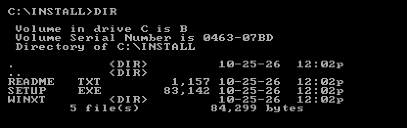
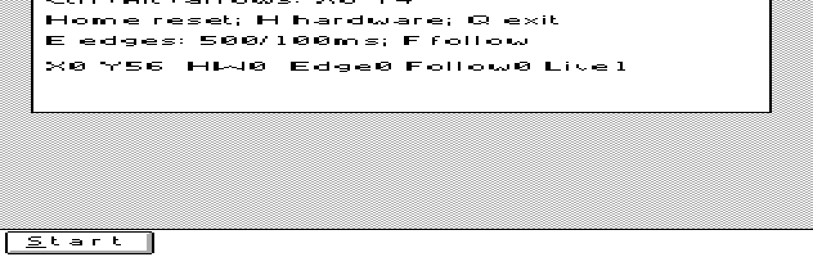

# Windows XT

[Download the Windows XT pack](https://github.com/astrobleem/oemdisplay-tandy/releases/download/windows-xt/WXTF1107.ZIP).
The target is an original Tandy 1000 EX/HX with normal 640 KB and Windows 3.0
real mode. Original Windows and DOS are required. Installation runs on the
DOS computer itself; the full installer requires DOS 3.3 or later.

## 1. Extract the download

Extract `WXTF1107.ZIP` on the DOS computer. Keep `SETUP.EXE`, `README.TXT` and
the expanded `WINXT` folder together. The folder contains the actual drivers,
apps, fonts, grabber and logos; the ZIP is no longer needed.



*This example uses `C:\INSTALL`. Your extraction folder can have another name.*

## 2. Choose the full installation

Exit Windows. At the DOS prompt, change to the folder containing `SETUP.EXE`.
For an existing Windows installation in `C:\WINDOWS`, run:

```bat
SETUP UPDATE C:\WINDOWS
```


*Press Enter to install the full desktop and applications.*

If you use the separate UISET compact-controls add-on, follow its restore
step first: `UISET C:\WINDOWS OFF` for each enabled display mode before
updating that driver. The full pack supplies the original controls, not the
optional resource overlay.

For a new Windows installation, insert the first original Setup disk and run:

```bat
SETUP FRESH A:\
```

The installer gathers Windows files automatically. When requested, insert the
next original Windows disk and press Enter. In a fresh Windows Setup, select
**Computer: Tandy 1000 EX/HX (WindowsXT)**; its preset selects the matching
display, keyboard and mouse. Follow Setup's prompts to finish.

## 3. Start using the desktop

The installer installs Tandy Start and the apps, then starts Windows.



*Windows is running. This view has been moved down to show Start; the viewport
controls remain open above it. Use `C:\STARTXT` for every later session.*

New installations default to fixed 320x200 with sixteen colors, without panning.
Updates preserve the installed display choice. The same folder offers four
other optimized fixed profiles through Windows Setup: 640x200 four colors,
320x200 four colors, 160x200 sixteen colors and 640x200 monochrome.

HPXY remains optional. With HPXY, the display supplies a 640x256 desktop
through a 320x200 view. PAN settings select the available movement and follow
options. Ctrl+Alt+arrows move the view and Ctrl+Alt+Home returns home.
The screenshot above illustrates that optional panning profile.

Choose **System > Screen saver** for Cube, Starfield, Matrix or Ovals.
The default idle delay is five minutes; updates preserve your existing settings.
Maze is no longer a saver choice. Existing user-owned Maze files and menu
entries are not deleted.

See [Panning settings](PANNING.MD) for the available approaches, including the
window workspace on fixed-resolution drivers and its Home recovery control.

## Optional application fonts

Setup copies the optional font folder to `C:\WINXT\FONTS` without registering
fonts or altering your existing application-font choices. In Windows, open
**Control Panel > Fonts > Add**, browse to that folder and select the Tandy
fonts you want. Read its `README.TXT` before adding the compact Helv fonts:
they share the Helv family and can change existing applications' font selection.

The pack also includes the compatible narrow M/W System font for XTC displays.
Updates recognize the selected original or earlier narrow XTCSYS by its
complete contents. Unknown/custom font files or shadow files are refused
rather than overwritten.
Fresh fixed320 continues to use the unchanged XTE fonts.
[Font details](FONTS/README.MD).

## Drivers only

For drivers only, use the same expanded folder as an ordinary Windows Setup
source. Follow the [illustrated Display / Other walkthrough](DRIVERS.MD).
This path leaves Tandy Start and the apps uninstalled and does not require
running the custom `SETUP.EXE`. The included `README.TXT` and
`WINXT\DISPLAY.TXT` also provide instructions without images.

[Screenshot details](SETUP/CAPTURES.MD).
