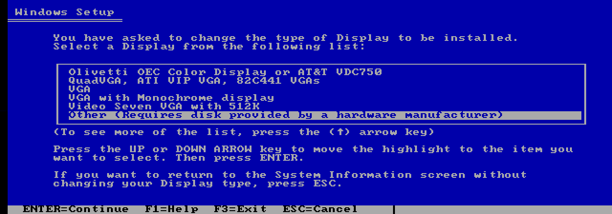
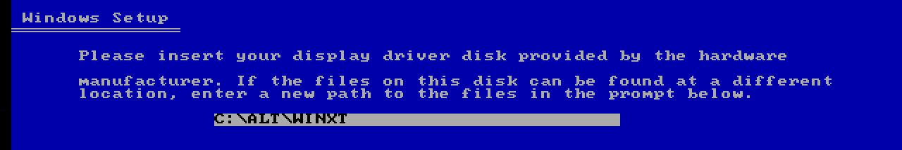
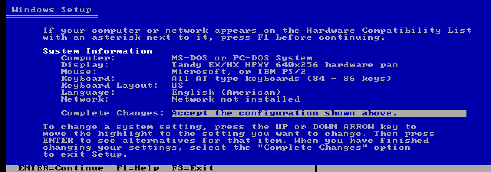

# Windows XT: drivers through Windows Setup

[Download WINXT.ZIP](https://github.com/astrobleem/oemdisplay-tandy/releases/download/windows-xt/WINXT.ZIP) and extract it. The same download
offers the [full desktop installation](DESKTOP.MD) and a complete driver source
in its expanded `WINXT` folder. Drivers only do not require the custom `SETUP.EXE`.

Use installed Windows 3.0 real mode on an original Tandy 1000 EX/HX with
normal 640 KB and DOS 3.20+. Fonts, grabber and startup artwork are included.

## 1. Start Windows Setup

Exit Windows. At the DOS prompt, change to the extracted `WINXT` folder and
run `DISPLAY`. This example extracted the download into `C:\ALT`:

```bat
C:
CD \ALT\WINXT
DISPLAY
```

## 2. Choose Display, then Other

Use the arrow keys to highlight **Display** and press Enter. In the display
list, move down to **Other** and press Enter.



*Other lets Windows Setup read the driver from your extracted folder.*

## 3. Point to the expanded folder

Enter the full path to the folder containing `OEMSETUP.INF`, then press Enter.
For this example it is `C:\ALT\WINXT`, rather than `C:\ALT`.



*Use your own extraction path. If Setup later asks for the Windows XT driver
disk, enter this same path again.*

## 4. Select the driver and finish

Select **Tandy EX/HX HPXY 640x256 hardware pan** and press Enter. Back on the
System Information screen, choose **Complete Changes** and press Enter.
Keep your keyboard, mouse and DOS configuration choices unchanged.



*Check the Display line before accepting. Setup copies the included fonts,
grabber and startup artwork along with the driver.*

If HPXY was already selected, Windows Setup can retain its existing driver
bytes. After Setup returns, `DISPLAY` checks the selected HPXY driver and
asks before replacing only `SYSTEM\HPXY.DRV` from this folder. Type **Y**
to accept; Enter, **N** or end of input leaves it unchanged. The prompt can
also appear after canceling Setup while HPXY remains selected. No replacement
is offered when another display is selected.

This use of the included `FIXXT` does not repair shell, keyboard, mouse, sound,
startup commands or INI settings. It supports DOS 3.20 through checked close
and driver readback; the full desktop installer still requires DOS 3.3+.

## 5. Launch Windows

For every session, return to the expanded `WINXT` folder and run `DISPWIN`.
For the example above:

```bat
C:
CD \ALT\WINXT
DISPWIN
```

In Windows, run `PAN /SETTINGS` for viewport controls. The normal launcher
installs it automatically.

`DISPLAY` and `DISPWIN` reserve shared video memory automatically and stop
if reservation fails. They use Windows in `C:\WINDOWS`; for another directory,
pass its drive and path, such as `DISPLAY D: \WIN30` and `DISPWIN D: \WIN30`.

Ctrl+Alt+arrows pan the 320x200 view over the 640x256 desktop;
Ctrl+Alt+Home returns home. PAN or Ctrl+Alt+H switches software/hardware
presentation. Exit Windows before changing display drivers through Setup.

[Other hardware](PLATFORM.MD) uses its matching packet. [Native installation
evidence](../tools/XROEM/NATIVE.JSN) records the alternate-folder Setup and launch test.

The included `WINXT\DISPLAY.TXT` has the same instructions without images.
[Screenshot details](SETUP/CAPTURES.MD).
