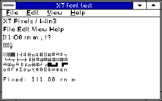
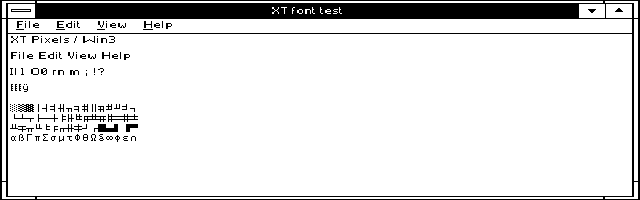
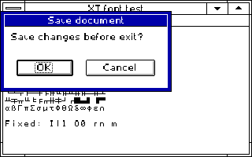
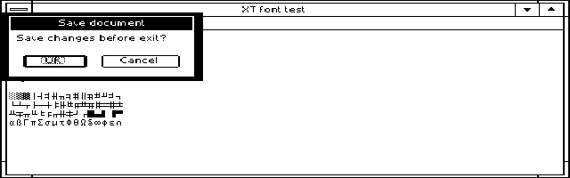

# Windows XT fonts

Windows XT includes original MIT-licensed System, Fixed and OEM bitmap
fonts for its graphics profiles, plus a fixed text-mode System font.
Current packets select their compatible XTC*/XTE*/XTTSYS aliases through
Setup or their installation helper. You do not need to collect CGA/EGA
font files. Start with [current downloads](../DOWNLOADS.MD) for your driver.

The [glyphs and generator](../../tools/XTFONTS/README.MD) document the
resource contracts and reproducible source. The records below preserve the
original R10 qualification; each current packet has its own install guide
and support integration checks. Windows itself remains a prerequisite.

## Current narrow System font

The current Windows XT pack keeps **M** and **W** at nine-pixel advances, with
seven-pixel ink. Five capitals (I, J, C, E and S) each gain one blank trailing
spacing pixel. This spacing adjustment leaves all font headers, bitmap data
and character offsets unchanged.
This preserves Windows 3.0's eight-pixel horizontal dialog unit, avoiding the
clipped Add Fonts and Notepad labels caused by narrowing M/W alone.

The compatible asset and portable builder are under
[`tools/XTFONTS/COMPAT`](../../tools/XTFONTS/COMPAT/XTCSYS.FON) and
[`COMPAT.PY`](../../tools/XTFONTS/COMPAT.PY); `COMTEST.PY` checks exact generation,
all 256 glyphs and all possible final sampled bytes in Win3's dialog-unit
calculation. The earlier M/W-only `NARROW` asset is retained as historical
source, not installed by the current pack. XTC Fixed/OEM and all XTE fonts
remain unchanged.

## Optional proportional application fonts

The pack includes XT Tandy I, XT Tandy II and XT Tandy 2K, each in 8-row and
12-row forms. These are six optional application font files, not System,
Fixed or Terminal replacements. Their advances vary from two to nine pixels.
The reported point sizes depend on display DPI; row height is the useful
fixed comparison between these strikes.

Full Setup copies the files and their original notices to `C:\WINXT\FONTS`.
Open **Control Panel > Fonts > Add**, browse to that folder and select the
fonts you want. Drivers-only users can browse to the `WINXT\FONTS` folder
inside the extracted packet. Setup does not register these fonts or change
existing `WIN.INI` application-font entries.

The three compact `CG1HELV`, `CG2HELV` and `CG6HELV` files are also included.
They all use the **Helv** family and can affect an existing Helv registration
if added. Leave them unselected to keep the existing Helv choice. Retain
both included license notices. Source and exact generation checks are in
[`tools/PROPFONT`](../../tools/PROPFONT/README.TXT).

## Current font integration checks

The compatible System font passed native Windows 3.0 checks in all five
fixed Tandy modes and HPXY: 4,608 System/Fixed/OEM byte-glyph cases, plus
Calculator, Fonts/Add, Notepad Open/Find and control interactions. The
unchanged fixed320 XTE dialogs remained pixel-identical. Existing off-screen
dialog limits at narrow resolutions are unchanged.

The final optional files passed actual Control Panel installation, a cold
restart, font enumeration and exact selection. All nine together passed
2,304 byte-glyph pixel, width and extent checks with normal 640 KB. Removing
only the three new Helv entries restored the original Helv and six Tandy
registrations; cold rendering and application dialogs passed afterward.
Windows left the unregistered Helv files on disk. Existing System/Fixed/OEM,
driver and original Helv files remained unchanged.

Native fresh preparation and the finishing/update paths were tested. A
separate original Windows Setup attempt stalled during hardware detection,
before copying Windows files, so a complete clean OS installation is not
qualified by this update. These are emulator checks, not physical-hardware
validation. No EMS, XMS, UMB, OS patch or weakened reservation guard was used.

## Original R10 qualification

[Final qualification](../QUAL/FONTSR10.JSON) binds the exact R10 disk, runtime,
helper, source and fonts. Both normal and explicit /VERIFY font-free DOS
preparation, Setup, cold Win3 GDI rendering and exact rollback passed. All
113 original Windows files and both boot files matched after rollback,
including deliberately edited INIs. Normal diagnostic SHA/readback/comparison
counters were zero. /VERIFY exercised SHA, readback and comparison checks.

The complete-byte fixtures verify all 256 byte inputs for each stock font,
every advertised glyph/advance and default substitution. TXTSYS was also
verified in graphics. Five graphics modes passed stock metrics and System/
OEM pixels. Host checks reject malformed offsets/resources and reproduce
all 7 FONs exactly. CI packages those same native-tested binary bytes; it
does not rebuild native code or launch an emulator.

The qualified zero-SHA/faster START base is retained, including its Settings
and Computer-profile fixes. ZEROFAST and related records are historical base
evidence; FONTBLD/BUILD.JSON are pre-native build snapshots. FONTSR10 and the
release QUALIFY.JSON supersede their pending flags for these exact bytes.
The old wording inside the tested image is retained to keep its bytes exact;
follow current START-HERE and the user manual.

## Native captures and limits

| Final 320 alias transaction | Earlier 640 fixture, same R10 font bytes |
| --- | --- |
|  |  |
|  |  |

These are genuine unscaled Windows 3.0 Tandy emulator captures. The 640 run
predates the filename aliases, with identical font bytes. HOST renders and
atlases are separately labeled by the generator. No physical 8088 timing
qualification is claimed. The exclusive emulator lease was released.

At 160 pixels menus wrap and the 218-pixel probe dialog clips. An original-font
control reproduced identical metrics and geometry; preserving metrics cannot
make every wide Windows dialog fit. At 320/640 the probe and button labels fit.
Experimental 80x25 text still has known extended-character/adjacent-cell
corruption; it is not visually qualified. No ROM bitmap atlas was extracted.

ASCII, Latin-1 and early Windows ANSI forms are drawn. Reserved ANSI bytes
7F,80,81,8D,8E,8F,90,9D,9E use visible boxes; Euro/later ANSI/Unicode emoji
are not supplied. OEM covers the original advertised 01..FE CP437 range;
00/FF use its original blank-space default. Modern Unicode GDI maps five
reserved ANSI bytes differently; direct native byte tests passed all 256.
See HOST/MISSING.JSON and the generator's coverage report.
