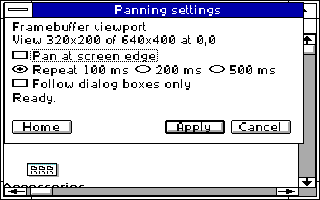
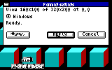
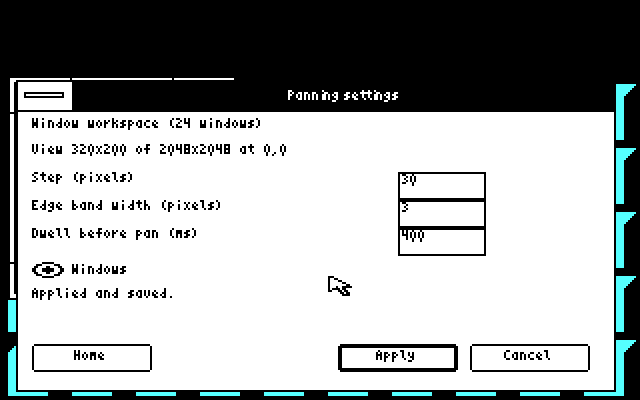
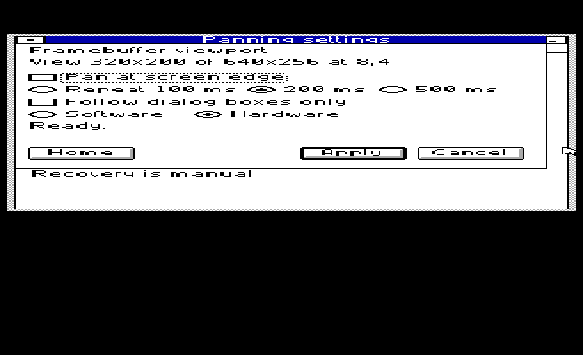

# Panning

Panning is one application: **PAN**. It detects the installed display driver,
starts one appropriate backend and uses the same settings and queued controls.
You do not choose a helper program by name.

For an existing supported display installation, download [PAN.ZIP](https://github.com/astrobleem/oemdisplay-tandy/releases/download/windows-xt/PAN.ZIP).
Extract it and, outside Windows, run `SETUP C:\WINDOWS` from the extracted root.
The updated Windows XT, CGA, PCjr and ColorPlus driver packets also include
PAN, so those driver installations need no second package or helper copying.
For another existing supported display, use PAN.ZIP. Start Windows normally
afterward.
An explicit previous OFF choice stays OFF through reinstalling.

Inside Windows, run `PAN /SETTINGS`, or press **Ctrl+Alt+S**. Reopening settings
keeps the running backend and unfinished edits. Apply saves; Cancel discards
unapplied edits. `PAN OFF` disables panning and its next-session startup;
`PAN` enables it again.

**Ctrl+Alt+arrows** move the view or window workspace. **Ctrl+Alt+Home** returns home;
**Ctrl+Alt+End** brings the active window into view. The owner applies queued
commands after busy drawing completes; the input hook never draws.

## The selected display determines the presentation method

| Installed display | Desktop and visible view | Available presentation |
| --- | --- | --- |
| PCjr or ColorPlus panning display | 640x400 desktop, 320x200 view | Software framebuffer viewport, both axes |
| Tandy EX/HX extended display | 640x256 desktop, 320x200 view | Software or Hardware, chosen in settings |
| CGA large-desktop 160x100 display | 320x200 desktop, 160x100 view | Software framebuffer viewport, both axes |
| Fixed 160/320/640x200 display, including fixed text, or fixed CGA160x100 | Existing fixed screen; optional window workspace | Moves windows, both axes |

These are backends of PAN, not different panning applications. Hardware mode
appears only where the installed driver supports it. A window workspace keeps
the fixed framebuffer; it moves existing windows rather than inventing a larger
framebuffer. Changing a Windows 3.0 display driver requires exiting Windows.

The PCjr and ColorPlus software desktop uses two 64,000-byte shadow bands:
128,000 bytes total, 64,000 more than the former vertical-only desktop. It keeps
the existing 32 KB physical video page. Normal 640 KB and real-mode Windows
remain required; no EMS, XMS or 386 is needed. Keep using your adapter packet's
normal guarded launcher. The common installer upgrades only the exact preceding
vertical panning drivers; it retains unrecognized driver variants.

The updated PCjr/ColorPlus, Tandy extended and CGA framebuffer backends provide
horizontal and vertical movement. Actual
workspace dimensions and step alignment follow the adapter's memory and driver
constraints. Settings show only controls the selected presentation supports.
Fixed CGA 160x100 window movement retains its five-pixel step. The optional
legacy text-mode framebuffer keeps its existing vertical viewport and memory
limits; PAN also controls it. The fixed text profile can use the two-axis window
workspace. These retained display profiles are not separate panning programs.

## Native screens and test scope

The shared dialog adapts to the physical view, including 160x100. PCjr and
compact CGA images decode captured native video memory at the logical pixel
resolution; other images are emulator captures. None are mockups or physical-machine
photographs. [Native evidence](QUAL/PAN/README.MD) records the tested bytes,
installation paths, memory and limitations.

This PCjr image is decoded directly from the captured native 32 KB video page,
using the adapter palette; it shows the real running application.

