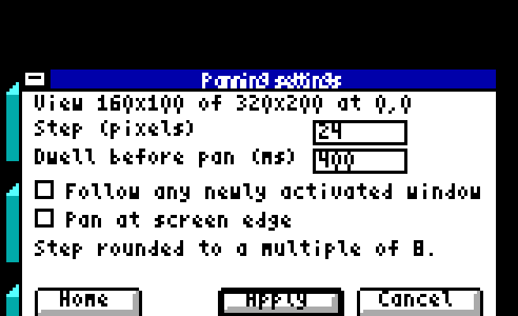

# Panning controls

Install your adapter's current packet using its normal Setup entry. It installs
and selects the matching helper automatically. In Windows, run `PANCFG /SETTINGS`
or press **Ctrl+Alt+S**. Reopening settings keeps your existing owner and unfinished
edits. Apply saves changes; Cancel discards unapplied edits.

| Selected display | Available approach |
| --- | --- |
| HPXY | Existing Software or Hardware viewport, chosen in settings |
| PCjr / ColorPlus software panning | Vertical framebuffer viewport |
| CGAPAN | 160×100 view of a 320×200 desktop |
| Supported fixed 320×200 / 640×200 displays | Optional workspace that moves windows |
| Fixed CGA 160×100 | Existing window/client movement |

Settings show the capabilities of the selected display. Choosing an approach
does not require running two helpers. Fixed-display window movement keeps the
fixed framebuffer; it does not create hardware panning or a larger framebuffer.

**Ctrl+Alt+arrows** move the view or workspace. **Ctrl+Alt+Home** returns home;
**Ctrl+Alt+End** brings the active window into view. Existing adapter shortcuts
remain available. Step values follow each backend's alignment constraints.
Edge, dwell and follow options appear only where supported.

Run `PANCFG OFF` to close the owner and disable its next-session startup.
Run `PANCFG` to enable it again. Ordinary subsequent launches retain that choice.
On a supported fixed display, opening settings starts the optional workspace for
this session; `PANCFG` also enables its next-session startup.

The controls share a bounded key queue. Hooks only record commands; the owning
helper applies them outside the hook, so busy drawing can finish safely.

## Actual emulator screens

The adaptive settings layout fits the 160×100 view. This compact screen shows
fixed CGA window access; that backend retains its five-pixel step and offers
only Windows mode. Wider screens use the wider version of the same layout.
These are native emulator captures, not physical-hardware photographs.

CGAPAN after applying a requested step of 20: its horizontal alignment makes
the saved step 24.

Paintbrush in CGAPAN's larger desktop, from the preceding native qualification.
The display driver and Paintbrush rendering bytes are unchanged in this update;
see [CGA capture details](CGA/CAPTURES.MD).

