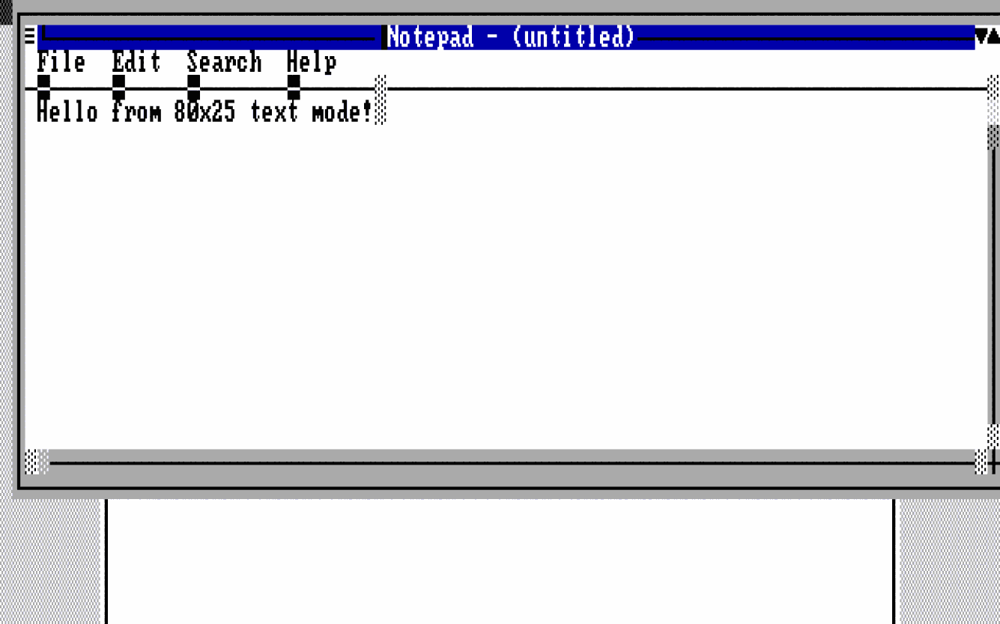
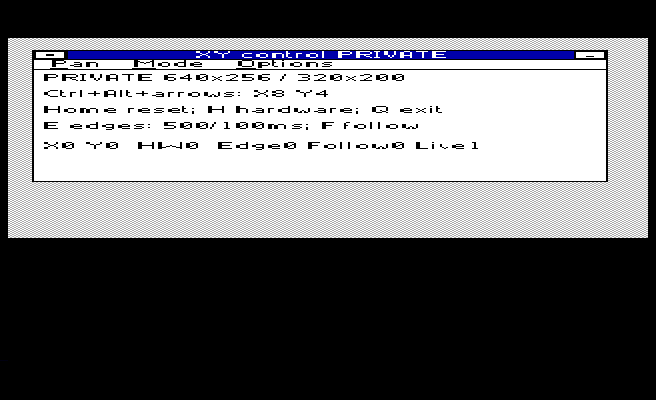
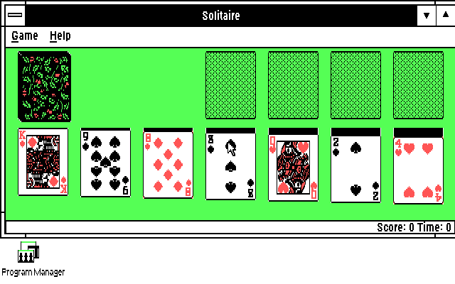
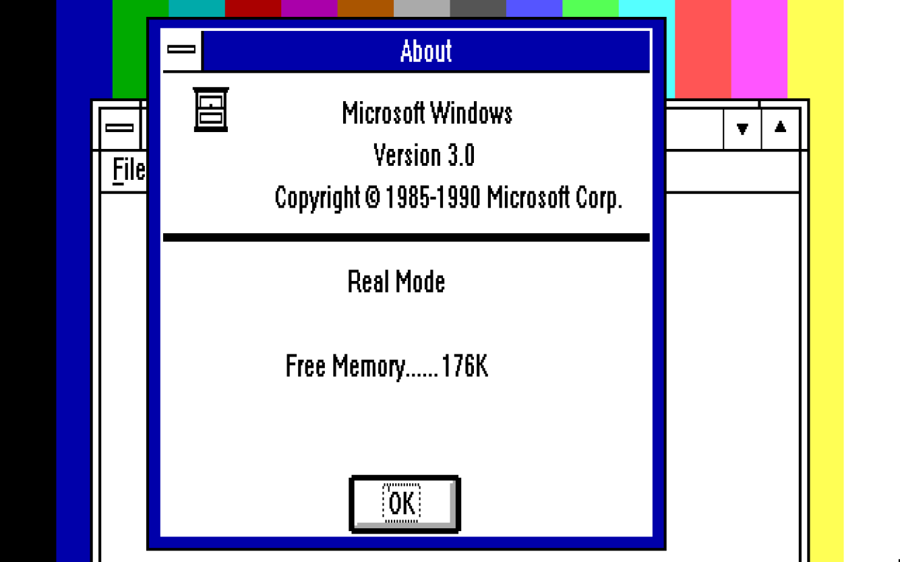
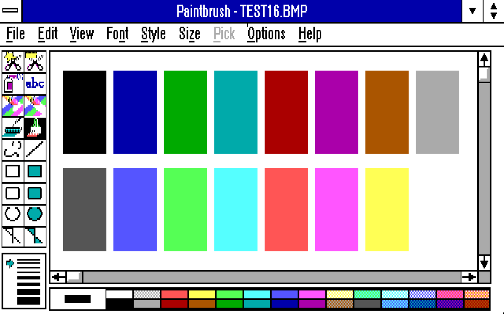
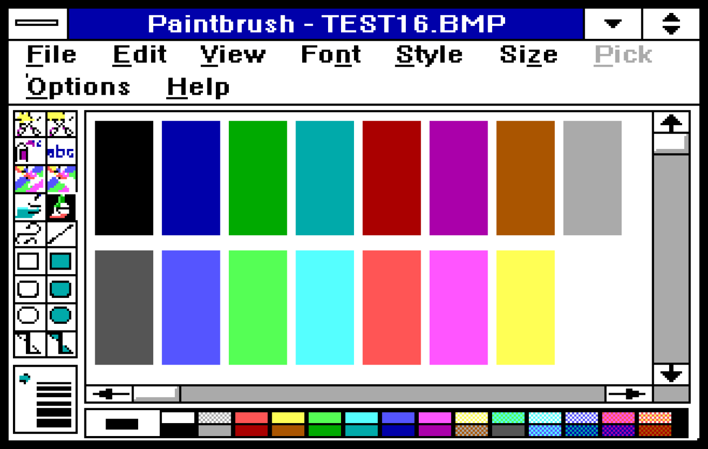

# Display drivers and compatible systems

Explore sixteen-color graphics, a larger panning desktop, or Windows made of
text cells. Find your machine below, then follow its download and setup guide.

[Text-mode Windows](#text-mode-windows) · [Tandy EX/HX](#tandy-exhx-graphics) ·
[Other systems](#other-machine-specific-graphics) · [Panning](#panning) ·
[Screenshots](#screenshots-from-windows)

**Status and evidence:** these packages are experimental Windows 3.0 real-mode
software. **Emulator-tested** identifies a Windows run on the named setup;
**host-checked** covers builds/models without a Windows runtime test;
**hardware-reported** identifies an owner's physical-machine result. Shared
adapter targets remain unverified until tested. The screenshots are authentic
existing emulator captures; physical results are reported separately. Windows 3.1 is unsupported.

Graphics modes below give **width × height, displayed colors and color depth**:
2 colors = 1 bpp, 4 = 2 bpp, 16 = 4 bpp. A panning desktop is larger than its
visible viewport. Text modes list character grids separately from the logical
pixel surface and palette Windows uses.

**At 160×200**, current fonts and standard window controls are crowded and
can clip. A compact font/control-metrics profile for this resolution remains
future work.

## Text-mode Windows

**[A Windows desktop made of character cells](https://github.com/astrobleem/text-mode-windows).**
Ordinary Windows applications run through a hardware text presenter. The compact
C25 profile gives window controls their own cells, as shown here in Notepad.

*86Box · IBM XT / IBM CGA · T80CMP.DRV (C25) · 80×25 characters, 640×200
logical desktop · Notepad. [Session record](text80/RUN_c3/c80w3/T80WIN.JSN).*

**[Download TEXT80.ZIP and follow the install guide](../downloads/experimental/TEXT80/README.MD).**
The 25, C25 and PAN profiles share a CGA-compatible color-text path targeting
IBM CGA, Tandy 1000 EX/HX, PCjr-class video, EGA and VGA; VGA 80×50 has its own
BIOS checks. All four use a 16-color logical palette, presented through
foreground/background character attributes.

| Profile / driver | Visible character grid | Windows desktop | Windows evidence |
| --- | --- | --- | --- |
| C25 — `T80CMP.DRV` | 80×25 | 640×200 | Emulator-tested: IBM XT/CGA. |
| 25 — `TEXT80.DRV` | 80×25 | 640×200 | Earlier builds: 86Box XT/CGA and Tandy HX. |
| PAN — `T80PAN.DRV` + `XTPAN.EXE` | 80×25 view over 80×50 logical cells | 640×400 | Earlier build: 86Box XT/CGA; software panning. |
| VGA — `T80VGA.DRV` | 80×50 | 640×400 | Earlier build: DOSBox-X VGA; full desktop visible. |

**Current package:** C25 matches its GUI-tested driver. The current 25/PAN/VGA
builds are host-checked and await a fresh Windows run. EGA and PCjr adapter
coverage is still a target. Text cells can have different physical glyph
heights while representing the same 8×8 logical pixels. Larger fonts and
graphics become block approximations; scrolling is slow, CGA can snow, and
compact controls work best on the cell grid. [Full behavior and limits](TEXT80.MD).

The earlier text experiments are also available:

| Driver | Display and palette | Systems / status | Guide |
| --- | --- | --- | --- |
| `TXT40.DRV` | 40×25 color characters; 320×200 logical pixels, 16-color palette | CGA-compatible color-text target; emulator-tested on IBM XT/CGA RGB and composite output. | [TXT40 and captures](TXT40.MD) |
| `TXTMODE.DRV` | 80×25 characters; 640×200 monochrome logical surface | DOSBox-X Tandy-mode feasibility proof; retained in the older Windows XT package. Text restoration and window movement can corrupt characters. | [Historical proof](../experiments/TEXTMODE/README.MD) |

## Tandy EX/HX graphics

**[Current XRSYNC display download and install](RELEASES/XRSYNC.MD)** for
existing Windows 3.0. The complete desktop installer remains [rc.8](RELEASES/RC8.MD).

The original **Tandy 1000 EX and 1000 HX** share these drivers. Use 640 KB RAM
and the package's reservation helper/guarded launcher, including lower-color
modes. These are EX/HX packages; Video II systems use the separate driver below.

| Driver / fixed-mode variant | Visible screen | Windows desktop | Status / notes |
| --- | --- | --- | --- |
| `HPXY.DRV` (XR1) + `XYCTL.EXE` | 320×200, 16 colors / 4 bpp | 640×256 | Emulator-tested; hardware and software panning. **[Current rc.8 download and setup](RELEASES/RC8.MD).** |
| `TANDY88.DRV` / `TR53216.DRV` | 320×200, 16 colors / 4 bpp | Same as screen | Emulator-tested. |
| `TNDY6404.DRV` / `TR56404.DRV` | 640×200, 4 colors / 2 bpp | Same as screen | Emulator-tested; black/red/green/white. |
| `TNDY160.DRV` / `TR51616.DRV` | 160×200, 16 colors / 4 bpp | Same as screen | Emulator-tested. |
| `TNDY3204.DRV` / `TR53204.DRV` | 320×200, 4 colors / 2 bpp | Same as screen | Emulator-tested; black/cyan/magenta/white. |
| `TNDY6402.DRV` / `TR56402.DRV` | 640×200, 2 colors / 1 bpp | Same as screen | Emulator-tested; black/white. |
| `XTPAN.DRV` + `XTPAN.EXE` | 320×200, 16 colors / 4 bpp | 320×400; 320×300 build-only option | Vertical software panning; emulator-tested on HX and hardware-reported on EX. [Guide](PAN.MD). |
| `HPAN.DRV` R3 + `HCTL.EXE` | 320×200, 16 colors / 4 bpp | 640×200 | Horizontal hardware/software panning; emulator-tested, partial hardware report. [Candidate download and guide](../downloads/experimental/hpan-hpxy/README.md). |

Paired filenames identify original and later TR5 fixed-mode variants. See the
[five-mode guide](MODES.MD), [TR5 notes](TRIAL5/VERIFY.TXT) and retained
[rc.6 download](https://github.com/astrobleem/oemdisplay-tandy/releases/tag/v0.1.0-rc.6).
EX/HX BIOS 0Ah is **640×200 with four colors**. The older TNDY16, TANDYV1 and
TR3/TR4 checkpoints remain in the [development history](MODEHIST.MD).

## Other machine-specific graphics

| Driver | Systems / adapters | Windows mode | Status, download and setup |
| --- | --- | --- | --- |
| `TNDYV2.DRV` | Tandy 1000 **SL/2 family selector**; related SL/TL/RL models unverified | 640×200, 16 colors / 4 bpp | Emulator-tested: 86Box SL/2. 640 KB; T2RESV before Setup and every start. **Never use on EX/HX:** the guard cannot distinguish these models. [ZIP](https://github.com/astrobleem/oemdisplay-tandy/releases/download/experimental-video-ii-2026-10-14-r2/TNDYV2.ZIP) · [install guide](tga2/INSTALL.TXT) · [Video II guide](TGA2.MD). |
| `PC1512.DRV` | Amstrad PC1512 built-in video; **not PC1640** | 640×200, 16 colors / 4 bpp | Emulator-tested: 86Box PC1512. Cursor-state issue unresolved; Setup unverified. [ZIP](https://github.com/astrobleem/oemdisplay-tandy/releases/download/experimental-displays-2026-10-12/PC1512.ZIP) · [project](https://github.com/astrobleem/windows-3-amstrad-pc1512) · [install guide](../experiments/DISPLAY3/PC1512.TXT) · [guide](PC1512.MD). |
| `TNDYJR.DRV` | IBM PCjr | 320×200, 16 colors / 4 bpp | Emulator-tested: DOSBox-X PCjr, clean and existing-install Setup. JRGUARD requires an already reserved DOS video page. [PCJRSET.ZIP](https://raw.githubusercontent.com/astrobleem/oemdisplay-tandy/main/downloads/experimental/PCJR/PCJRSET.ZIP) · [project](https://github.com/astrobleem/windows-3-pcjr) · [install guide](../downloads/experimental/PCJR/README.MD). |
| `PCP3216.DRV` | XT-class PCs with the ColorPlus family listed below | 320×200, 16 colors / 4 bpp | Emulator-tested: 86Box IBM XT + Plantronics ColorPlus. [ZIP](https://github.com/astrobleem/oemdisplay-tandy/releases/download/experimental-displays-2026-10-12/PCP3216.ZIP) · [project](https://github.com/astrobleem/windows-3-plantronics) · [install guide](../experiments/DISPLAY3/PCP3216.TXT) · [guide](PCP.MD). |
| `PC1YAMA.DRV` | Olivetti Prodest PC1 / Yamaha V6355D, **B000h** | 160×200, 16 colors / 4 bpp | Host-checked; runtime and Setup unverified, screenshot pending. [PC1 ZIP](https://raw.githubusercontent.com/astrobleem/oemdisplay-tandy/main/downloads/experimental/yamaha-candidate03/PC1-B000-CANDIDATE03.ZIP) · [project](https://github.com/astrobleem/windows-3-olivetti-pc1) · [guide](../experiments/YAMAHA/README.MD). |
| `YAM160.DRV` | Standalone Yamaha V6355D **B800h** card profile on IBM XT | 160×200, 16 colors / 4 bpp | Emulator-tested: 86Box scanout; separate DOSBox-X API/raw-VRAM tests. Public-packet Setup unverified. [B800 ZIP](https://raw.githubusercontent.com/astrobleem/oemdisplay-tandy/main/downloads/experimental/yamaha-candidate03/YAMAHA-B800-CANDIDATE03.ZIP) · [Yamaha guide](yamaha/QUALIFICATION.MD). |

**One ColorPlus driver, several adapter targets:** Plantronics ColorPlus,
ATI Graphics Solution / Small Wonder, Paradise EGA 480 in CGA mode (including
Amstrad PC1640), Yamaha V6355-based cards, Twinhead CT-6190G,
VTech VTCL 27-0739-01 and some Tandy add-in cards. These share the
[ColorPlus register/memory contract](PCP.MD#target-hardware); the tested card
is Plantronics ColorPlus. Its hardware also offers 640×200×4, while
`PCP3216.DRV` implements 320×200×16. The Yamaha B000/B800 profiles above are
separate paths.

**CGA, including [Graphics Gremlin](https://github.com/schlae/graphics-gremlin),
already has a Windows path:** stock `CGA.DRV`, 640×200 monochrome / 1 bpp.
Gremlin's CGA implementation uses that driver; its VGA connector does not add
Windows VGA modes. [Stock-CGA emulator example](ALTMODES.MD#stock-cga-windows-control);
a Gremlin-specific runtime proof is still pending.

**AT&T DEB / Olivetti M28 EGC** remains a native foundation blocked on the
palette contract, rather than a working Windows display driver. Other hardware
ideas live in the [survey](GAPSURV.MD).

## Panning

**Tandy can pan in hardware and software today.** The viewport is the portion
you see; Windows can arrange windows across the larger desktop behind it.

| Panning driver | Visible view → Windows desktop | Hardware presentation | Software presentation |
| --- | --- | --- | --- |
| Current XR1 / HPXY | 320×200 → 640×256, 16 colors | X/Y, 8-pixel horizontal and 4-pixel vertical steps | Full viewport copy; startup default and recovery path |
| HPAN R3 | 320×200 → 640×200, 16 colors | Horizontal panning | Full-copy fallback |
| XTPAN | 320×200 → 320×400, 16 colors | — | Vertical panning |
| T80PAN | 80×25 characters → 640×400 logical pixels | — | Whole text-row panning |

HPXY R1 panning was accepted on the owner's real **Tandy 1000 EX**. The current
XR1 package has emulator evidence; see the [hardware reports and version scope](SHOWCASE.MD#panning-on-real-tandy-hardware)
and [XR1 controls](RELEASES/RC8.MD). The fixed-mode builds keep desktop and
screen the same size; they do not define a platform's panning limits.

**Future work — source-based candidates, not additional implemented modes:**

| Candidate | Useful starting point | Main work remaining |
| --- | --- | --- |
| PCjr / ColorPlus | XTPAN's shadow desktop, viewport/cursor translation and helper | Closest software ports. Preserve PCjr's reserved page or ColorPlus's two planes; hardware panning needs adapter-specific CRTC and bank-wrap tests. |
| PC1512 / Video II | HPXY/TEXT80 segmented virtual-bitmap infrastructure | Larger shadows and new presenters for masked planes or linear Video II memory; validate addressing, cursor and timing. |
| Yamaha | XTPAN's software viewport design | Establish PC1 runtime first; adapt B000/B800 layout and cursor separately. |
| CGA / Graphics Gremlin | T80PAN's shared text path; monochrome renderer for a graphics extension | Test the actual adapter/current PAN build; a graphics viewport needs its own implementation. |

Shared renderer code makes these practical starting points, but a CRTC start
register alone does not provide a larger Windows desktop. [XTPAN design](PAN.MD)
and [TEXT80 panning](TEXT80.MD#4-panning-pan-profile) cover the memory and layout details.

## Screenshots from Windows

### Tandy EX/HX

*HX emulator · HPXY.DRV XR1 · 320×200×16 view over 640×256 · XYCTL at home
in Software mode after installation. [Install record](QUAL/XR1/INSTALL.JSN).*

*DOSBox-X Tandy · TNDY6404.DRV · 640×200×4 · Solitaire's four-color table.
Row-doubled capture. [Capture record](modes/6404rg/CAPTURE.JSON).*

### Video II and PC1512

| Tandy SL/2, Video II | Amstrad PC1512 |
| --- | --- |
|  |  |
| 86Box SL/2 · TNDYV2.DRV · 640×200×16 · Windows About. [Capture record](tga2/P86RAW.JSN). | 86Box PC1512 · PC1512.DRV · 640×200×16 · Reopened Paintbrush image. [Capture record](pc1512/P86RAW.JSN). |

### PCjr and ColorPlus

| IBM PCjr | IBM XT + ColorPlus |
| --- | --- |
|  |  |
| DOSBox-X PCjr · TNDYJR.DRV · 320×200×16 · Clean-install desktop. [Session record](pcjr/INSTALL/SESSION.JSN). | 86Box IBM XT / Plantronics ColorPlus · PCP3216.DRV · 320×200×16 · Reopened Paintbrush image. [Capture record](pcp/P86RAW.JSN). |

### Standalone Yamaha B800

*86Box IBM XT / standalone Yamaha V6355D B800h · YAM160.DRV · 160×200×16 ·
Program Manager. The PC1 uses the separate B000h profile. [Capture details](yamaha/QUALIFICATION.MD).*

### Wider panning desktops

| HPAN R3 | HPXY R1 |
| --- | --- |
|  |  |
| 86Box Tandy HX · HPAN.DRV R3 · 320×200×16 view / 640×200 desktop · Menu at the edge. | 86Box Tandy HX · HPXY.DRV R1 · 320×200×16 view / 640×256 desktop · Panned desktop and menu. |

[HPAN/HPXY capture records and downloads](../downloads/experimental/hpan-hpxy/README.md)
· [Watch XTPAN's vertical software-panning demonstration](pan/DEMO.GIF)
· [Back to Windows XT](../README.md)
