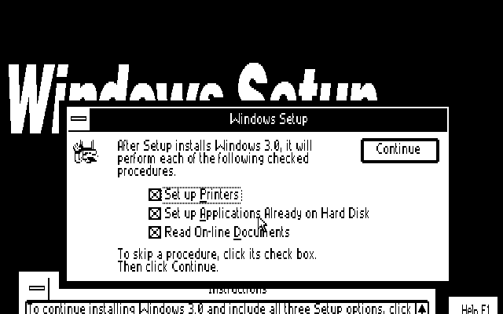
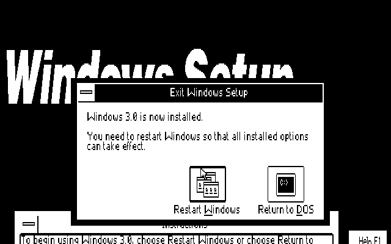
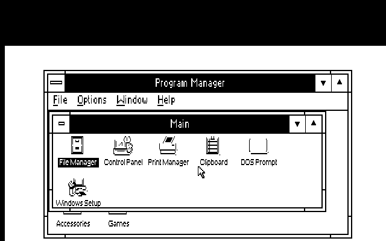

# Fresh CGA graphical Setup qualification

The exact native launcher and dedicated single-choice CGA640 OEM kit reach
original Windows 3.0 graphical Setup on an emulated IBM XT, 4.77 MHz 8088,
640 KB, RGBI CGA and DOS 6.22. Windows is absent at the start. No installed
driver is replaced as a substitute for a fresh test.

`NATIVE.JSN` binds the final archives, original-media identities, selected
boot entries, installed support, refusals and cleanup. `EXACTRUN.JSN` retains
the controller actions. `BUILD.JSN` and `HOST.JSN` pin the build and an
identical standalone-source rebuild. `RUNTIME.JSN` documents the final
archive's instruction/notice changes after native staging; all twelve runtime files
are identical. The original four floppy images were copied unchanged into
one private media-source directory; a full floppy-swapping sequence was not
exercised. Original Setup copied/decompressed the OS in the emulated 8088.

`FIRST.JSN`, `FIRST-RUN.JSN` and `FIRST.PNG` retain the earlier architecture
test using the accepted CGA packet directly on PC-DOS 3.20. That is separate
from the new launcher's DOS 3.3+ test. `PREFLIGHT.JSN` retains the failed
missing-path launch attempt, which started no emulator. The private harness
sources are retained developer evidence and reference external owned OS
fixtures/dependencies. They are not consumer preparation tools.

**Scope:** entry into the original graphical Setup options dialog. Complete
OS installation, a first ordinary WIN /R start, other fresh profiles, and
physical hardware remain untested. Existing installed-driver qualifications
are not inherited as fresh-install results. No publication is authorized.
Both owned emulators stopped, the shared byte lease was released and checked
available afterward, and emulator inventory ended at zero. No playback or
runner is queued. Disk images, OS files, compiler and emulator are excluded.

## Completed installation and first normal startup

`FULL.JSN` separately binds the completed installation on the reused DOS 6.22
image. The original Setup shell resumes normally with WIN /R; no display or
INI change is made. Original Setup installs the remaining files and fonts,
reports Windows 3.0 installed, and returns to DOS. A separate FIRST.BAT runs
ordinary WIN /R, which reaches Program Manager. Normal Exit Windows returns
to DOS and writes FIRSTRUN.TXT. All seven selected display-support files still
match, shell is PROGMAN, and all 282 original-media source files are unchanged.

The entry-only scope above remains the historical c009241a record. The new
completion evidence is in FULLRUN.JSN, FULLPREP.JSN, COMPLETE.CNF and the
sealed return markers. Optional printers, application scan and document
viewing were skipped. Suggested DOS boot changes were saved as backups.
Physical hardware, other fresh profiles and actual floppy swapping remain
unqualified. No publication is authorized by these test receipts.
