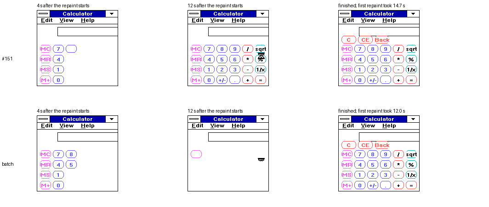

# Fill-row batching between GDI's scan markers (experimental)

**Summary.** This experiment builds on PR #151's driver. When GDI fills a
RoundRect or Ellipse, it sends one Output call per row, bracketed by begin
and end markers (Output styles 80 and 81). #151 copies each of those rows
from the shadow to the screen as soon as it is drawn. This change instead
holds the rows and copies them once, as a single row range, when the end
marker arrives.

**Exactness.** Pixels are identical to both #151 and the original TR5
driver, in all 14 final frames and in **every intermediate frame after
each of 14 single calls**.

**Speed:**

* **No cursor over the drawing:** the gain is small. Calculator's full
  repaint goes from 10.33 s to 10.16 s (−1.6%).
* **Cursor over the shapes:** the gain is large. Under the arrow cursor,
  20 Calculator keys go from 9.56 s to **6.04 s (−37%)**.
* **Hourglass over Calculator** (as when Calculator is opened): the first
  repaint goes from 14.7 s to **12.0 s (−18%)**.

Reversi and Paintbrush are unchanged: Paintbrush never sends the markers,
and Reversi's fills are tiny.

**Cost:** 146 bytes of code and 6 bytes of data. The driver file grows by
144 bytes in every profile.

Three deliberately broken versions are each caught.

Branch `ai/fillrow-batch`, based on #151 (`ai/roundrect-speed`). This is
emulator evidence only: no release default, package, pin or accepted hash
changes, and dot's compact/panning work is not touched.

*Real 86Box captures (Ctrl+F11, decoded exactly), with the hourglass
over the keypad. At 4 s the batch driver has drawn more keys. Its first
repaint ends at 12.0 s, against 14.7 s for #151 (empty cells: that
capture fell after the first repaint). The final Calculator, Reversi and
Paintbrush captures of the two drivers are pixel-identical
([SHOTS](rrbatch/SHOTS)).*

## 1. What was left after #151, measured

Removing every fill-row copy from #151, which gives wrong output and
exists only to measure (`mut-scanskip`, [RRECT.MD](RRECT.MD) section 5),
takes Calculator's repaint from 10.4 s to 7.7 s. **So the fill-row copies
cost 2.7 s; this is the ceiling for any change to them.** (#151's report
put this at "about 4 s"; that figure also included the outline copies.)

Each fill row is a different screen row, so batching does not reduce the
number of rows converted. It saves only the fixed cost of each separate
copy. That cost is large in exactly one situation: when the copied rows
meet the cursor. The cursor then has to be erased and redrawn around each
copy (TCURSOR's legacy hide/show path), once per row instead of once per
shape.

## 2. Do the markers safely delimit the operation?

* **Pairing, observed.** The trace runs record every Output call: both
  probe versions in #151 and this branch's batch-trace run. They contain
  **3,008 fill rows in 298 begin/end pairs**. Every fill row lies inside
  a pair; no pair is nested, interleaved with any other style, or left
  unterminated ([TR_BATCH.TXT](rrbatch/TR_BATCH.TXT) for this branch).
* **Clipping.** GDI clips the rows before calling the driver. Clipped and
  partly off-screen shapes still send paired markers (roundrect_clipped:
  20 of 20). Shapes entirely off the screen send nothing to hold.
* **Nested or interrupted calls.** These cases fall back to the existing
  behaviour:
  * a begin marker while a batch is open first copies what is held;
  * any other screen Output style also copies it first and ends the
    batch, as does any other drawing entry: BitBlt, Pixel, ScanLR,
    StrBlt or ExtTextOut;
  * fill rows outside a batch are copied immediately, exactly as in #151;
  * output to memory bitmaps never reaches this code.

  So a batch whose end marker never arrived is copied by the next driver
  call.
* **Cursor.** TCURSOR keeps the cursor overlay in video memory only, and
  its interrupt-time MoveCursor erases and redraws against video memory.
  It never reads the shadow, so holding rows in the shadow does not change
  what the cursor saves or restores. The held range is copied through the
  same FlushRetainRows and cursor_begin_retain/end_retain as every other
  bounded copy. The cursor tests below pass exactly.
* **Residual risk, stated plainly.** Suppose GDI sent a begin marker and
  fill rows, and then made no further driver call at all. Those rows would
  stay unpresented until the next drawing call. This was never observed,
  and GDI sends both markers within a single RoundRect or Ellipse call.
  Closing this case would need a timer-driven copy at interrupt time, which
  TR5 deliberately avoids.
* **Visible tradeoff.** Within one RoundRect, the fill now appears all at
  once at the end marker instead of row by row. This is invisible between
  API calls: the per-call frames are identical.

## 3. The change

`RRPATCH.patch_batch` applies on top of `patch_candidate` (#151); see
[RRPATCH.PY](../src/rrect/RRPATCH.PY). It adds five bytes of state:
`rr_bopen` and the held range `rr_bfirst`/`rr_blast`.

* **BatchClose:** copies the held range through FlushRetainRows (if it is
  not empty), then resets it.
* **Begin marker:** BatchClose, then open a batch. **End marker:**
  BatchClose.
* **Fill row (style 4, bounded) inside an open batch:** widen the held
  range instead of copying.
* **`rr_settle`:** inserted at BitBlt, Pixel, ScanLR, StrBlt, ExtTextOut
  and every other screen Output style. If a batch is open, it calls
  BatchClose.

Each edit must match its anchor an exact number of times (four for the
shared drawing-entry prologue). BUILD88's instruction, REP-prefix and
link audits pass.

**Code and memory cost**, kept separate from timing
([COST.JSN](rrbatch/COST.JSN)):

| Item | #151 | Batch | Change |
| --- | --- | --- | --- |
| `_TEXT` (code) | 16,290 bytes | 16,436 bytes | +146 |
| `_DATA` | 898 bytes | 904 bytes | +6 (5 bytes of state, word-aligned) |
| Driver file | 54,992 bytes | 55,136 bytes | +144 |

The other four profiles also grow by 144 bytes each; they were built, not
run. No new segment, buffer, TSR or BIOS service is added. Compared with
the original TR5 driver, #151 and batching together add 240 bytes.

## 4. Matched runs: exact pixels

All runs use the same 86Box 6.0 `tandy1000hx` setup: 8088 at 7,159,092
Hz, 640 KB, XTIDE, the same PC DOS 3.20 + Windows 3.0 image, and the same
probe (RRBENCH version 4). Only the driver differs.

RRCMP refuses incomplete runs, compares all 32,768 bytes of each frame,
and now also compares the frame after every single call of the new
`visible_steps` stage. That stage draws 14 shapes, with the arrow cursor
over the first ones:

* pen fill, no-pen fill and XOR over both;
* hollow, and clipped to a small region;
* off the top-left corner, off the left edge, entirely above and entirely
  right of the screen;
* an Ellipse and a Rectangle;
* a large white shape, a no-pen XOR, and the bottom-right corner.

A decoded sheet of the batch run's frames is in [STEPS.PNG](rrbatch/STEPS.PNG).

| Comparison | Result |
| --- | --- |
| original TR5 vs #151 | 14/14 frames and 14/14 per-call frames equal |
| original TR5 vs batch | 14/14 and 14/14 equal |
| #151 vs batch | 14/14 and 14/14 equal |
| #151 vs batch-trace | 14/14 and 14/14 equal |
| #151 vs batch screenshot runs (frames) | 3/3 equal; final captures identical |

## 5. Timings (#151 vs batch, same probe, same setup)

| Stage | #151 | Batch |
| --- | --- | --- |
| Calculator full repaint (x3) | 10.33 / 10.38 / 10.33 s | 10.22 / 10.16 / 10.16 s |
| Calculator, hourglass over the keypad (screenshot runs, x3) | 14.72 s | **12.03 s** |
| Calculator launch to painted, hourglass | 19.1 s | 16.5 s |
| 20 keys under the arrow cursor (cursor_overlap) | 9.56 s | **6.04 s** |
| 20 Calculator keys | 4.72 s | 4.61 s |
| 20 no-pen keys | 2.53 s | 2.47 s |
| XOR / overlap keys | 4.34 / 4.45 s | 4.28 / 4.39 s |
| Reversi full repaint | 1.43 s | 1.43 s |
| Paintbrush full repaint | 4.56 / 4.50 / 4.50 s | 5.55 / 4.56 / 4.50 s |

Paintbrush sends no scan markers (the trace shows only 42 polylines), so
batching cannot affect it. Its first repaint varies from run to run
between 4.5 and 5.5 s under every driver (5.49 s under both drivers in
the screenshot runs). For reference, the original TR5 driver takes 92.6 s
for the same Calculator repaint. Raw logs: `rrbatch/<run>/RRBENCH.LOG`.

## 6. Broken versions are caught

| Broken version | What it gets wrong | Caught by |
| --- | --- | --- |
| mut-noend | end marker closes the batch without copying it; rows wait for the next begin marker | 3 per-call frames differ, plus the no-pen stage |
| mut-short | the copied range stops one row early | 8 per-call frames differ, plus the no-pen stage |
| mut-early | each held row is copied *before* the renderer draws it (premature) | 9 per-call frames differ, plus the no-pen stage |

Difference images are in `rrbatch/D_*`. In the timed stages, shapes drawn
with a pen hide all three faults: the outline's own copy covers the fill
rows. That is why the per-call `visible_steps` frames and the no-pen
stages exist.

[RRTEST.PY](../src/rrect/RRTEST.PY) adds tests that a changed per-call
frame, a missing per-call dump, or a missing per-call log entry each fail
even when the final frames match. It also checks the batch patch's
structure and anchor counts, and every committed rrbatch log, comparison
and driver hash. `.github/workflows/rrect.yml` runs it.

## 7. Recommendation and next step

* **Batching is safe in every case tested.** It pays off mainly when the
  cursor is over what is being drawn: the hourglass while an application
  paints, or the arrow over a dialog. Whether 146 bytes is worth an 18%
  faster Calculator open, but only 1.6% when the cursor is elsewhere, is a
  judgement for whoever adopts it. It should not be adopted without #151,
  which it depends on.
* **Most of the remaining fill cost is not per-copy overhead.** It is
  converting full 320-pixel rows for 26-pixel-wide keys. TR5 already has a
  column-bounded copy (FlushRetainColumns, used by BitBlt). Bounding fills
  and outlines by their X range could cut that conversion roughly tenfold,
  and would combine naturally with the held range. That is a separate
  experiment and is not done here.
* **Emulator only;** the HX stands in for the EX. Only 320x200x16 was run.
