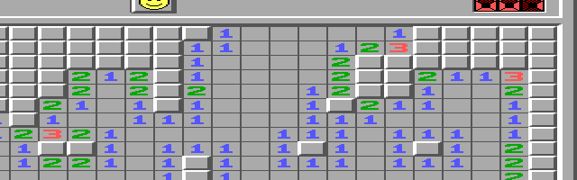

# Windows XT demos and capture notes

The front page shows what Windows XT looks like. This page keeps the detailed
capture provenance, measured comparisons and package distinctions together.
The pictures below are emulator captures; separately described physical
acceptance is not a claim that a screenshot came from hardware.

For downloads and installation use the [front page](../README.md#get-started).
The current installer and Minesweeper download are in the [rc.8 guide](RELEASES/RC8.MD).
Historical records remain in the [rc.7 notes](RELEASES/RC7.MD) and
[rc.6 qualification](QUAL/RC6.MD).

## Startup, desktop and colors

The front page's startup, hill desktop, moon-and-stars shutdown and before/after
color comparison retain the original visual tour. The four-color picture comes
from [the owner's earlier video](https://www.youtube.com/watch?v=yNisFBDLXos&t=1230s).
It and the sixteen-color Paintbrush picture compare appearance in different
modes, not performance. See the [original showcase/capture notes](PROMO/SHOWCASE.MD)
and [color comparison record](PROMO/SHOWCASE.MD#earlier-windows-30-video).

*DOSBox-X guest capture · Windows 3.0 real mode · Tandy 320×200×16 logical mode, displayed doubled. The hill wallpaper is optional and separate from RC6. [Capture provenance](PROMO/SHOWCASE.MD) · [capture commit 43cf098](https://github.com/astrobleem/oemdisplay-tandy/commit/43cf0984f1d3da389231c55cdd82d8757074836a).*

## A desktop taller than its screen

*86Box 6.0 · Tandy 1000 HX, 8088 at 7.16 MHz · Windows 3.0 real mode · 320×200×16 viewport over a 320×400 logical desktop. Existing captured frames; the [33/33 session record](pan/FIT/XPWIN.JSN) is preserved at [test commit 6d48868](https://github.com/astrobleem/oemdisplay-tandy/commit/6d48868aa62fa5b7cf5d6ed8946dd7984582ace7).*

The XTPAN prototype makes lower windows and buttons reachable without changing the 320×200 display. Keyboard pans, edge dwell, cursor rendering and mouse hit-testing were checked; one 275-row dialog's bottom button was clicked after panning. This is software viewport panning, not CRTC hardware scrolling, and it is not in RC6. A Tandy 1000 EX owner reports XTPAN works on real hardware, but no scripted physical test of this software-panning prototype is recorded. The separate HPXY hardware-pan results below do not qualify XTPAN. See the [full investigation](PAN.MD).

A converted Minesweeper demonstration shows one board extending below the 200-row viewport. The app conversion is specific to this application. [Download the converted app and About shim](https://github.com/astrobleem/oemdisplay-tandy/releases/download/v0.1.0-rc.8/WINMINE30.ZIP); the packet includes installation instructions, notices and exact prior test scope.

*Cropped emulator capture · 86Box native headless · emulated Tandy 1000 HX, 8088 at 7.159090 MHz, 640 KB · Windows 3.0 real mode · 320×200×16 viewport over 640×256 logical space. The MNSN2 emulator run passed four snapshots with zero viewport/display mismatches. It used the then-private combined HPXY XR1 PR151 + E1 runtime. The linked component commit does not identify the complete capture build; current rc.8 has its own release pins and install qualification. No combined-runtime hardware qualification is claimed. [Capture/test provenance](pan/MINE/CAPTURE.MD) · [public PR151 component commit fc7b09b](https://github.com/astrobleem/oemdisplay-tandy/commit/fc7b09bdbe7e37dc9d562bdb746cf435b0628ba0).*

*Cropped emulator capture · same 86Box/Tandy 1000 HX setup · viewport origin (160,40). This large jump used a planned full viewport copy with hardware enabled and CRTC start 840; it is not an incremental staged pan or a retrace fault. The combined runtime remains physically untested. See the [separate HPXY R1 hardware acceptance](#panning-on-real-tandy-hardware) and [capture record](pan/MINE/CAPTURE.MD).*

## Panning on real Tandy hardware

Panning keeps a 320×200 display while bringing the rest of a larger Windows desktop into view. HPXY R1 has been tested and accepted on the owner's real Tandy 1000 EX: Windows 3.0 real mode, stock-CGA profile, 7.16 MHz 8088, 640 KB. The scoped run recorded 54 pans, including 53 hardware operations, no ERROR records, return to software presentation at (0,0), and Windows exit code 0. That acceptance applies to this HPXY R1 configuration; it does not qualify other machines, display profiles or Windows 3.1. The current [rc.8 installer](RELEASES/RC8.MD) includes the combined XR1 panning driver/helper and wheel system, with emulator fresh/update qualification. It makes no new hardware claim. RC6 remains unchanged and does not include panning.

| HPAN R3 | HPXY R1 |
| --- | --- |
|  |  |
| 86Box · Tandy 1000 HX · Windows 3 real mode · 320×200×16 display over 640×200 logical space. [Download HPAN R3 ZIP](https://raw.githubusercontent.com/astrobleem/oemdisplay-tandy/7c119ac1ee5428fa1a3a3c37e49d340c0f363150/downloads/experimental/hpan-hpxy/HPAN-R3-PHYSICAL-ACCEPTANCE.zip). Its separate physical record is a short 0→104→0 run; it is not the accepted HPXY R1 hardware result. | 86Box · Tandy 1000 HX · Windows 3.0 real mode · 320×200×16 display over 640×256 logical space. [Download HPXY R1 ZIP](https://raw.githubusercontent.com/astrobleem/oemdisplay-tandy/7c119ac1ee5428fa1a3a3c37e49d340c0f363150/downloads/experimental/hpan-hpxy/HPXY-R1-EXPERIMENTAL.zip). The bundled frame is emulator evidence; the physical EX acceptance above is separate. |

The ZIPs are repository downloads, not GitHub Release assets or installers. The [package guide, installation and rollback instructions](../downloads/experimental/hpan-hpxy/README.md) lists each binary hash and its original emulator evidence. The E1 + PR #151 combined runtime's qualification remains separate from this physical HPXY R1 acceptance. The current rc.8 package supplies the completed combined runtime; the older rc.7 component/overlay downloads remain unchanged.

## Same Calculator, less waiting

*86Box 6.0 · Tandy 1000 HX, 8088 at 7.16 MHz · Windows 3.0 real mode · TR5 320×200×16. This is a fixed-time screenshot sequence: the unchanged driver still lacks the Back key at 95 seconds; the candidate is complete at 14.7 seconds.*

In a separate matched timing run, one Calculator repaint fell from **92.5 to 10.4 seconds**; all 13 compared frames were byte-identical. The bounded-copy change merged in [PR #151](https://github.com/astrobleem/oemdisplay-tandy/pull/151) at [commit fc7b09b](https://github.com/astrobleem/oemdisplay-tandy/commit/fc7b09bdbe7e37dc9d562bdb746cf435b0628ba0). It is emulator-only, tested only in 320×200×16, and is not in the RC6 download. The compact Start is already in RC6. The renderer optimization and panning now ship together in rc.8. Their combined runtime and E1 edge cadence remain physically untested. The rc.7 downloads retain their original component-only scope. See the [full test record](RRECT.MD) and [evidence commit](https://github.com/astrobleem/oemdisplay-tandy/commit/3ece9ee38ecce27c726aa9c73c815632b28589c9).

## Readable text and compact controls

*Genuine Windows 3.0 Tandy-emulator capture · native 320×200×16 · unscaled. The capture record does not name a specific emulator model; see [screenshot provenance](FONTS/SHOTS/README.TXT) and [capture commit b07a4ca](https://github.com/astrobleem/oemdisplay-tandy/commit/b07a4cad7b0e646e71402ff420d958093c2bc768).*

RC6 supplies original XT Pixels System, Fixed and OEM fonts with the inspected Windows metrics intact. At 320 pixels, text and common controls remain readable alongside Tandy Start; at 160 pixels some menus wrap and wide dialogs still clip. See the [font qualification](FONTS/README.MD) and [font evidence](QUAL/FONTSR10.JSON). The taller-desktop experiment above is separate work for windows that do not fit.

## Apps, input and sound

The vertical-pan test keeps cursor shape and click targets aligned as the view moves; its keyboard shortcuts and edge-dwell controls are listed in [PAN.MD](PAN.MD). Small Windows apps provide more examples: [Tandy Maze](../examples/MAZE/GAME/README.MD), [Tandinator](../examples/TANDINAT/README.MD), [Pinball](../examples/PINBALL/README.MD), [Starfield](../experiments/VISPART2/README.MD) and [Matrix](../experiments/VISPART1/README.MD).

Owner-reported input highlights include mouse-wheel scrolling in Program
Manager, File Manager and Notepad on a real Tandy 1000 EX, plus Hold opening
Tandy Start. The [Windows XT desktop bundle](DESKTOP.MD) includes WHEEL.DRV,
WXTWHL and their configuration. Its wheel qualification is emulator-only;
the owner's hardware report remains separate. Windows 3.1 is unsupported.
The optional [WHEEL.EXE DOS diagnostic](../tools/WHEEL/WHEEL.EXE) and its
[instructions](../tools/WHEEL/README.TXT) check mouse/serial data. The
compatible [TNDYK3 keyboard candidate](../src/tandyk3/README.md) is separate.

*Unmodified emulator capture · emulated Tandy 1000 HX, 8088 at 4.772728 MHz, 640 KB, stock CGA · Windows 3.0 real mode. The published capture record does not name the emulator product. [Capture provenance and image hash](https://github.com/astrobleem/oemsound-tandy/blob/824ae10e1d79d1bd2d09f4a37447f58dd9cc9476/docs/SHOTS/WINAMP3.MD) · [tested UI record](https://github.com/astrobleem/oemsound-tandy/blob/824ae10e1d79d1bd2d09f4a37447f58dd9cc9476/experimental/WINAMP30/VALIDATION-UI.MD) · [source commit 824ae10](https://github.com/astrobleem/oemsound-tandy/commit/824ae10e1d79d1bd2d09f4a37447f58dd9cc9476). The app's separate physical acceptance is on a real Tandy 1000 EX, 7.16 MHz 8088; see the [scoped acceptance record](https://github.com/astrobleem/oemsound-tandy/blob/824ae10e1d79d1bd2d09f4a37447f58dd9cc9476/experimental/WINAMP30/EVIDENCE/PHYSICAL.JSON).*

**[Download Tandy Winamp](https://github.com/astrobleem/oemsound-tandy/releases/download/tandy-winamp-xt1.20261024/TWXT1.ZIP)** · [Install guide](https://github.com/astrobleem/oemsound-tandy/blob/main/experimental/WINAMP30/INSTALL.TXT)

Tandy Winamp UX3 browses and adds music, manages a scrollable 32-entry playlist, and plays MIDI, supported VGM/VGZ and PSG-adapted MOD. On the real EX, the user accepted Browse/Add, Remove and scrolling past four songs; music also continued while they used Program Manager. Its separate HX emulator suite passed 396 native UI checks and 88 audio/event regression checks. This app update is separate from the Windows XT RC6 package.

For PSG music, Fiddle/Beats authoring and PIT speaker tools, use the
[sound downloads guide](https://github.com/astrobleem/oemsound-tandy/blob/main/docs/DOWNLOADS.MD).
[libwintandy](https://github.com/astrobleem/libwintandy/tree/24ff4f932c0d4d4e2a18a3c49b0ea0a8ff90e71f) publishes shared 8086 Windows 3.0 helpers and a source-inclusive [VGM/VGZ and bounded MOD format-preview package](https://github.com/astrobleem/libwintandy/blob/24ff4f932c0d4d4e2a18a3c49b0ea0a8ff90e71f/examples/FORMATS30/LibWinTandy-Win30-Formats-Gzip-Fix-Preview-20261017.zip). This is an opt-in preview, not a stable release or general-purpose emulator: VGM/VGZ accepts a defined Tandy SN76496 command subset, while MOD becomes a square-wave PSG arrangement without sampled timbres. See the [format limits and test record](https://github.com/astrobleem/libwintandy/blob/24ff4f932c0d4d4e2a18a3c49b0ea0a8ff90e71f/examples/FORMATS30/README.md).

## Screen savers

| Starfield | Matrix |
| --- | --- |
|  |  |

The [showcase record](PROMO/SHOWCASE.MD) describes these saved captures.

[Back to Windows XT](../README.md) · [Other machine packages and captures](PLATFORM.MD)
