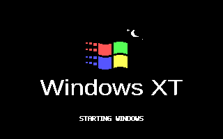

# Windows XT user manual

[Project and downloads](../README.md) · [Install](#install-windows-xt) ·
[Display modes](#choose-a-display-mode) · [Tandy Start](#use-tandy-start) ·
[Experimental drivers](#separate-experimental-drivers) ·
[Recovery](#restore-your-previous-installation)

Windows XT adds five graphics modes, a compact Start-menu desktop, original
bitmap fonts, games and utilities to **Windows 3.0 real mode on a Tandy 1000
EX/HX with 640 KB RAM**. The current main package is the experimental
**[0.1.0-rc.6 preview](https://github.com/astrobleem/oemdisplay-tandy/releases/tag/v0.1.0-rc.6)**.
You supply DOS and Windows; the downloads contain no Windows installation.



*Actual emulator capture of the accepted Color startup wave.
[Capture details](PROMO/XTWAVE.JSON). Physical hardware performance is unqualified.*

This manual follows current main and the separately published experimental
packets. The [manual saved with rc.6](https://github.com/astrobleem/oemdisplay-tandy/blob/v0.1.0-rc.6/docs/USERMAN.MD)
is the immutable release snapshot. Updating this guide does not requalify
or replace those release binaries.

## Pick a download

| Your machine or goal | Download and guide |
| --- | --- |
| **Original Tandy 1000 EX/HX, everyday graphics preview** | **[WINXT720.ZIP](https://github.com/astrobleem/oemdisplay-tandy/releases/download/v0.1.0-rc.6/WINXT720.ZIP)**, or the [720 KB image](https://github.com/astrobleem/oemdisplay-tandy/releases/download/v0.1.0-rc.6/WINXT720.IMG). Follow the installation below. |
| Try 80-column text, including compact C25 | Separate **experimental [TEXT80.ZIP](../downloads/experimental/TEXT80/TEXT80.ZIP?raw=1)** and [packet guide](../downloads/experimental/TEXT80/). See [TEXT80](#text80-and-compact-c25). |
| IBM PCjr with memory expansion | Separate **experimental [PCJRSET.ZIP](../downloads/experimental/PCJR/PCJRSET.ZIP?raw=1)** and [packet guide](../downloads/experimental/PCJR/). See [PCjr](#ibm-pcjr-clean-setup). |
| Tandy Video II, Amstrad PC1512 or Plantronics ColorPlus | Use the [machine-specific guides](#other-video-hardware). The EX/HX package does not select these drivers. |
| Add games or utilities to an existing installation | The separate [TANDYLAB catalog](../examples/TANDYLAB/CATALOG.TXT) and [experimental release](https://github.com/astrobleem/oemdisplay-tandy/releases/tag/experiments-2026-10-07) identify each packet and its instructions. |

Use the [rc.6 SHA256SUMS](https://github.com/astrobleem/oemdisplay-tandy/releases/download/v0.1.0-rc.6/SHA256SUMS)
to check that download on a modern computer. Each separate experimental
packet has its own checksums and qualification scope.

## Install Windows XT

### Before you start

You need a working Windows 3.0 installation, DOS 3.3 or later, an original
EX/HX with 640 KB, and writable storage for `C:\WINXT`. Keep a backup of
Windows and a way to boot DOS. These instructions use `C:\WINDOWS`;
[alternate paths and host staging](../distributions/WINXT/README.MD) have
additional limits. The integrated optional shell expects these default paths.

`WINXT720.IMG` is a **720 KB data floppy**, not a boot disk. Select it in a
GoTek, mount it as a floppy in your emulator, or write suitable double-density
media. Boot your normal DOS system first. A 360 KB-only drive cannot read it.
No Python, compiler or 1.44 MB controller support is needed on the Tandy.

The original MIT-licensed XT Pixels fonts, static logo and Windows XT artwork
are included. The preparation helper gathers the matching **CGA.GR2** grabber
from your own Windows files. Windows, Setup, WIN.CNF and other non-font
Windows components remain necessary. Keep the completed own-media folder
private; it contains your Windows support file.

### 1. Prepare the support folder

Exit Windows completely. At the DOS prompt, with the image in drive A:

```bat
A:
CD \
INSTALL
```

The helper looks in `C:\WINDOWS` and its `SYSTEM` directory. If it reports a
missing support file, supply a folder copied from your own Windows 3.0 media:

```bat
INSTALL C:\WIN30SRC
```

Use your actual source path; original compressed files are accepted. After
its checks and your confirmation, the helper creates a fresh `C:\WINXT`.
It refuses an existing output folder. Normal preparation uses size, I/O and
structural checks; `/VERIFY` is optional, slower developer diagnostics.

### 2. Select the display once in Windows Setup

Still outside Windows:

```bat
C:
CD \WINXT
INSTALL
```

This prepares the guarded launcher and recovery files, then starts your
Windows Setup. Choose **Display → Other display**, enter **`C:\WINXT`**, select
a graphics mode, and accept **Complete Changes**. Use `C:\WINXT` again if
Setup asks for its display disk. If asked about CONFIG.SYS, choose **option 3:
make no changes**. You can select your intended graphics mode directly here.

The installer also adds an optional **Tandy 1000 EX/HX (WindowsXT)** Computer
choice without selecting it or changing the active keyboard. Leave it alone
unless you want that compatibility preset; read [Computer setup guide](CPSET.MD)
before selecting it through `C:\WINXT\WINXT SETUP`. Reopen Setup afterwards
to check the saved display and keyboard. This preset installs no sound driver.

### 3. Add the optional Start desktop

For a fresh Tandy Start installation, run once from DOS:

```bat
C:\WINXT\TSSETUP
```

It refuses to overwrite existing shell files. For an existing Tandy Start,
follow its [upgrade instructions](../examples/TSHELL/README.MD#install-or-upgrade)
and keep your settings.

### 4. Start Windows

At the DOS prompt:

```bat
C:\WINXT\WINXT
```

**Use this guarded launcher every time, including lower-color modes.** It
recovers interrupted changes, reserves shared video memory, and starts
Windows in real mode. Resolve a refusal before starting Windows. With the
optional shell installed, supported graphics sessions use Tandy Start and
restore the original shell on exit. The bundled text experiment uses the
original Windows shell.

Color mode has the short flag-wave startup; other profiles retain static
startup. Press a key to skip the wave. To disable only the wave from DOS:

```bat
C:\WINXT\WAVEXT RESTORE C:\WINDOWS C:\WINXT
```

The [startup guide](../examples/WXTSPL/WAVE/README.MD) covers re-enabling it
and supported older installations.

## Choose a display mode

After the initial Setup installation, exit Windows fully and run:

```bat
C:\WINXT\MODES
```

Select one of the five graphics profiles. **U** restores the one previous
selection. Start again with `C:\WINXT\WINXT`. The menu prepares its mode
resources on first use; later changes use those resources without another
Setup installation. Keep `C:\WINXT` available for switching and recovery.

| Menu profile | Desktop | Palette | Driver |
| --- | --- | --- | --- |
| **32016** | **320×200** | **16 colors; default** | `TR53216.DRV` |
| 6402 | 640×200 | Black and white; more horizontal room | `TR56402.DRV` |
| 6404 | 640×200 | Black, red, green, white | `TR56404.DRV` |
| 3204 | 320×200 | Black, cyan, magenta, white | `TR53204.DRV` |
| 16016 | 160×200 | 16 colors; smallest desktop | `TR51616.DRV` |

For example, `C:\WINXT\MODES 6402` selects monochrome directly. Windows Setup
remains available through `C:\WINXT\WINXT SETUP`; use the mode menu for normal
changes. Read [MODEINFO.TXT](../distributions/WINXT/MODEINFO.TXT) for recovery
and the opt-in historical TEXT choice. Use these tools to change display
settings rather than editing SYSTEM.INI by hand.

The five rc.6 graphics modes have native Windows emulator checks. Earlier
physical reports include working Paintbrush/TSHELL and a faster monochrome
trial, but lack exact final-file hash readback. They do not qualify every
current binary. Original EX/HX 640×200 graphics has **four colors**, and its
physical behavior remains a particular test gap. [Hardware report scope](STATUS.MD).

Practical limits:

- At 160 or 320 pixels wide, stock dialogs can clip. **Alt+Space, X** maximizes
  an off-screen active window; keyboard shortcuts can reach clipped buttons.
- Stock Clock's digital digits are invisible in the 320×200 four-color
  palette. Use analog Clock or another mode there.
- Turn off a color wallpaper before switching to monochrome.
- Large redraws and some screen savers can still be slow on an 8088.

The rc.6 **80×25 TXTMODE** choice is an older feasibility driver with known
character, clipping and geometry corruption. It is separate from the newer
TEXT80/C25 packet below. Its [runtime notes](../distributions/WINXT/TEXTMODE.TXT)
record limits, including unverified full DOS-app switching. Tandy Start is
not qualified with this driver.

## Use Tandy Start

Tandy Start provides a compact Start button and clock bar. Program Manager
continues to edit your program groups; close and reopen Programs after saving
a group to refresh its contents. Existing groups are read-only to the shell.

| Control | What it does |
| --- | --- |
| **Programs** | Reads existing Program Manager groups, preserving arguments and working directories. The disk also supplies a Windows XT group with saver previews, About and Pinball. |
| **My Computer** | Opens or restores File Manager. |
| **Run → Browse** | Chooses an executable and launches it from its folder. Type DOS short paths in Run. |
| **System** | Opens About This Tandy and screen-saver settings. |
| **Clock** | Double-click for Clock/Calendar; right-click to adjust date and time. |
| **Exit Windows** | Confirms exit and lets apps ask about unsaved work. Hold Shift while selecting Exit to skip its chime. Enter or Escape initially cancels; E selects Exit. |

Maximized apps can cover the bar; it is not an application taskbar.
The [shell guide](../examples/TSHELL/README.MD) covers settings, upgrades and
recovery. Newer shell overlays have their own installation guides; use a
matching shell and TSINPUT.DLL pair.

### Browse existing long filenames

Run → Browse can show existing VFAT long names, including spaces. It always
navigates and launches using the **DOS short alias** shown below the list.
Labels are read-only; the shell does not create or rename long names or add
long-path support to other programs.

The verified reader requires **genuine DOS 6.22, Windows 3.0 real mode, and a
fixed, uncompressed local FAT12/FAT16 volume with 512-byte sectors**. This is
narrower than the installer's DOS 3.3+ requirement. Removable/floppy, network,
FAT32, SUBST/JOIN/ASSIGN and detected DriveSpace volumes use short names.
An emulator host-folder mount is outside the qualified raw-volume domain.

Listings above 128 filtered rows, unsupported or ambiguous entries, read
errors and exhausted limits fall back to aliases. Labels over 63 characters
are shortened with an ellipsis. [Requirements and fallback details](../distributions/WINXT/NAMES11.TXT).

### Keyboard, mouse and joystick

The ordinary Start button works with the stock keyboard driver. Optional
**Hold-to-Start** requires the supported real-mode Tandy ROM profile, a
compatible loaded keyboard driver and TSINPUT. A plain press/release of Hold
opens Start over another app; Escape returns focus. Modifier combinations,
modal dialogs and saver wake-up have separate handling.

The [TNDYK3 keyboard candidate](../src/tandyk3/README.md) has its own guarded
installer and rollback. The public K3TOOLS packet contains probes, not that
driver. Raw hardware press/release observations do not qualify Windows key
translation or physical Hold behavior. [Hold support and scope](../distributions/WINXT/HOLD14.TXT).

[EXJOY](../examples/EXJOY/README.MD) is an optional raw joystick diagnostic
with session-only calibration; physical input remains unverified. The public
[DOS wheel diagnostic](../tools/WHEEL/README.TXT) probes wheel/API and serial
data. It does not install Windows scrolling; the recovered Win3 wheel
extension is not a public driver download.

### Screen savers and sound

**System → Screen saver** selects None, Matrix, Maze or Starfield. Delay is
10–3600 seconds; Preview tries unsaved choices and Apply saves them. Starfield
has speed and 16/32/64-star options; sixteen stars is the lightest setting.
Maze can be very slow. These savers are visual effects, not password locks.

Tandy Start offers optional Tandy or XP-note startup and exit phrases. The
chime apps use the PSG directly; the optional Computer preset does not enable
PSG sound. Run only one PSG producer at a time. Hold Shift while choosing
Exit to skip its sound.

The separate **[OEMSound-Tandy](https://github.com/astrobleem/oemsound-tandy)**
project supplies Mini MIDI, Mini Piano, Beats Lab, Automatic Mouth, PSGPLAY
and other experiments. Use its [starter release](https://github.com/astrobleem/oemsound-tandy/releases/tag/sound-v0.1.0-preview.20261007)
and each app's guide. App-local MIDIMAP is not a system MIDI device or General
MIDI synthesizer.

## Games and utilities

The main disk includes Pinball, About and the three saver companions. Other
apps are separate downloads or source projects; follow their own guides.

| App | What to try |
| --- | --- |
| [Pinball](../examples/PINBALL/README.MD) | Space launches; Z/Left and / or Right control the flippers; P pauses. |
| [Cookie Clicker](../examples/COOKIE/README.MD) | Click or press Space, buy upgrades, save and load. Fits 160×200. |
| [Fly Swat](../examples/SWAT/README.MD) | Mouse-controlled fly hunting, pause/restart, windowed and fullscreen paths. |
| [Maze game preview](../examples/MAZE/GAME/README.MD) | A separate playable preview; the disk retains the older Maze saver. |
| [Tandinator](../examples/TANDINAT/README.MD) | Character guessing; [0.3.8](../experiments/TANDI11/README.MD) is a separate experimental packet. |
| [Green hill wallpaper](../examples/HILLS/README.TXT) | Native landscapes for the 160/320-pixel sixteen-color modes. |
| [XTEyes](../examples/XTEYES/README.TXT) / [Slosh](../examples/SLOSH/README.MD) | Pointer-following eyes and a tiny moving water surface. |
| [GIFLOAD](../examples/GIFLOAD/README.TXT) | Converts supported static GIFs to new palette-mapped BMPs for Paintbrush. |
| [App-local dialogs](../examples/COMMDLG/README.TXT) / [FileDrop](../examples/FILEDROP/README.TXT) | Demo-specific file dialogs and path-name transfer. |

Stock Windows apps shown in captures, including Paintbrush, Notepad and File
Manager, come from your own installation. The [TANDYLAB catalog](../examples/TANDYLAB/CATALOG.TXT)
and [optional experimental release](https://github.com/astrobleem/oemdisplay-tandy/releases/tag/experiments-2026-10-07)
list additional packets. Alternate shells and app overlays are not automatically
combined; read each packet's dependencies and rollback instructions.

## Separate experimental drivers

Use a separate, backed-up Windows 3.0 installation for these packets. Their
installers and launchers have their own contracts. They do not replace the
rc.6 drivers or change its defaults. Emulator qualification is recorded for
specific binaries and configurations; physical support is not implied.

### TEXT80 and compact C25

Download **[TEXT80.ZIP](../downloads/experimental/TEXT80/TEXT80.ZIP?raw=1)**,
read its [packet guide](../downloads/experimental/TEXT80/), and extract the
complete runtime folder to a writable DOS 8.3 path. It contains first-party
fonts and helpers; your own working Windows 3.0 installation remains required.

| Profile | Driver | Screen and purpose |
| --- | --- | --- |
| **C25** | `T80CMP.DRV` | 80×25 text, 640×200 logical desktop, compact character-cell controls. |
| 25 | `TEXT80.DRV` | 80×25 text, 640×200 logical desktop, standard controls. |
| PAN | `T80PAN.DRV` + `XTPAN.EXE` | An 80×25 view over a 640×400 logical desktop; uses more Windows memory. |
| VGA | `T80VGA.DRV` | Full 80×50 text, 640×400 logical desktop; requires VGA. |

CGA-compatible color adapters are the target for C25, 25 and PAN. Physical
adapters have not been qualified; a real IBM CGA can show snow. Large fonts,
icons and graphics appear as block approximations. C25 gives exact compact
controls when windows align to the eight-pixel grid; some dialogs and off-grid
controls remain approximate. Scrolling can take seconds on an emulated XT.

For a standalone test installation at `C:\WINTXT`, exit Windows, change to
the extracted runtime folder, then run:

```bat
T80ON C:\WINTXT C25
C:
CD \WINTXT
WIN /R
```

Use the actual directory containing your cloned Windows installation. To
change profile, exit Windows and run `T80OFF C:\WINTXT` from the packet folder
before running `T80ON` again with `25`, `PAN`, `VGA` or `C25`. In PAN, with
NumLock off, **Alt+PgDn / Alt+PgUp** pan and **Alt+F9** returns to the top;
the helper also follows windows and pointer-edge dwell.

To undo from DOS, run `T80OFF C:\WINTXT` from the runtime folder. It removes
its recorded INI changes while preserving unrelated later settings. Keep its
state and backup files until rollback succeeds. If it reports a damaged or
missing record, stop and read the [recovery instructions](TEXT80.MD#7-installing-and-removing-dos)
before using whole-file `T80SET RESTORE`, which discards later INI edits.
After rollback, use the previous display's required launcher; a Tandy graphics
installation still requires its video-memory guard.

The C25 driver matches the exact binary in the recorded **54/54** Windows
session on an emulated IBM XT/CGA. Current rebuilt TEXT80 25, PAN and VGA
bytes have fresh audits and presenter tests, but their earlier Windows GUI
sessions used older hashes; those rebuilt bytes have not booted in Windows here. See the packet's
qualification record for each profile's exact identity and test scope.
[Detailed behavior, evidence and limitations](TEXT80.MD).

### IBM PCjr clean Setup

Download **[PCJRSET.ZIP](../downloads/experimental/PCJR/PCJRSET.ZIP?raw=1)**
and follow the included `INSTALL.TXT`. Copy its complete install folder to
**`C:\PCJREXP`**. The fixed path matters to Setup and its launcher.

This experimental driver provides **320×200 in 16 colors**. You need your own
Windows 3.0 media, DOS, a hard disk and suitable PCjr memory expansion. Before
Setup, run:

```bat
C:\PCJREXP\JRGUARD
```

Continue only after **OK**. The guard checks that the 32 KB video page at
segments 1800h–1FFFh is already excluded from DOS allocation; **it does not
reserve RAM**. Run your own Windows Setup, select **Other display**, point it
to `C:\PCJREXP`, and choose **EXPERIMENTAL IBM PCjr 320x200 16 colors**. Choose
the PC/XT 84-key keyboard and the mouse option matching your hardware. Follow
the packet's remaining Setup choices and **return to DOS**, rather than
restarting Windows from Setup.

Start Windows every time with:

```bat
C:\PCJREXP\JRWIN
```

The clean-install Windows Setup flow passed **26/26 emulator checks**, and
this packet's driver matches the qualified pin. Real PCjr memory expansions,
keyboard, serial input and timing remain unqualified. PCjr-only DOS video
modes cannot switch away with Alt+Tab; finish that DOS program to return.
[Full installation, existing-install and recovery guide](../src/pcjr/INSTALL/INSTALL.TXT) ·
[Native session record](pcjr/INSTALL/SESSION.JSN).

### Panning experiments

Panning provides a viewport onto a larger Windows desktop; it does not
increase the physical screen resolution. It is separate from the rc.6 mode
menu. Install a panning candidate only through its own packet instructions.

- [XTPAN graphics](PAN.MD) exposes a 320×400 desktop through a 320×200 view.
  Its helper supports edge dwell, following new windows and Alt+PgDn /
  Alt+PgUp / Alt+F9. The documented emulator run took about one second per
  pan; that is not a physical timing measurement.
- TEXT80 PAN uses an 80×25 view over 80×50 logical rows. Its cell-based pan is
  much smaller to copy, but the 640×400 shadow substantially reduces free
  Windows memory. [Memory and behavior](TEXT80.MD#3-memory).
- HPAN R3 physical-aperture and combined HPXY candidates have separate
  qualification records. A physical report for one candidate does not
  qualify another build or combined XY behavior. Check the [project download
  status](../README.md) for their current packets and installation guides.

### Other video hardware

| Machine/card | Driver and installation guide |
| --- | --- |
| Tandy Video II, emulated SL/2 family | [TNDYV2.ZIP](https://github.com/astrobleem/oemdisplay-tandy/releases/download/experimental-video-ii-2026-10-14-r2/TNDYV2.ZIP) and [Setup/recovery](tga2/INSTALL.TXT). Run T2RESV successfully before Setup and every start. **EX/HX must not use it.** |
| Amstrad PC1512 | [PC1512 experimental packet](https://github.com/astrobleem/oemdisplay-tandy/releases/download/experimental-displays-2026-10-12/PC1512.ZIP) and [guide](../experiments/DISPLAY3/PC1512.TXT). One cursor-state case remains unresolved. |
| IBM XT + Plantronics ColorPlus | [PCP3216 experimental packet](https://github.com/astrobleem/oemdisplay-tandy/releases/download/experimental-displays-2026-10-12/PCP3216.ZIP) and [guide](../experiments/DISPLAY3/PCP3216.TXT). Requires the card and its dedicated VRAM. |

These have separate Windows 3.0 real-mode evidence and hardware limits. Other
Video II models are unqualified. [Olivetti PC1/Yamaha candidates](../experiments/YAMAHA/README.MD)
have separate experimental packets; standalone Yamaha emulator evidence does
not qualify physical PC1 hardware.

## Restore your previous installation

For Windows XT rc.6, exit Windows and use the numbered backup path printed
by INSTALL and recorded in `C:\WINXT\BACKUP.TXT`, for example:

```bat
C:\WINXT\BACKUP\B001\RESTORE YES
```

Use your actual number. This restores the saved Windows configuration and
resources and disables optional shell/wave dispatch. Added files can remain
inactive. Keep the backup until the restored system works. If a restore or
guarded startup refuses, preserve the files and resolve the reported error;
starting Windows another way does not repair it.

For **one display-mode change**, use **U** in `C:\WINXT\MODES`. For **TEXT80**,
use its `T80OFF` procedure. For **PCjr or another machine-specific driver**,
follow that packet's Setup and recovery guide. These procedures serve
different installations; choose the one that made your change.

## Test scope and useful reports

The rc.6 implementation has native DOS/Windows emulator checks covering
installation, five graphics profiles, mode switching, fonts and recovery.
Its PREPXT documentation pin data was then refreshed reproducibly on the
host; that refreshed helper was not rerun in the guest. The saved
[rc.6 qualification](QUAL/RC6.MD) preserves that exact scope. Separate
experimental packets identify their own hashes and acceptance records.

Emulator cycles and host elapsed times do not establish physical 8088 speed.
Earlier hardware observations do not qualify every current driver, app or
input path. Standard/enhanced mode and an unexpanded 256 KB EX are outside
this Windows 3.0 real-mode acceptance scope.

A useful issue report includes the machine and RAM, DOS/Windows versions,
package and driver SHA-256, mode, exact steps, expected and actual behavior,
and whether it ran on hardware or an emulator. Keep a working rollback.

[Development status](STATUS.MD) · [Build guide](../BUILDING.MD) ·
[Graphics mode contracts](MODES.MD) · [Source provenance](../src/tandysw/PROVENANCE.md)

Preserve component licenses and notices. Repository access does not grant
rights to Windows media, ROMs, proprietary fonts, compilers or emulators;
keep those out of redistributed packets.
