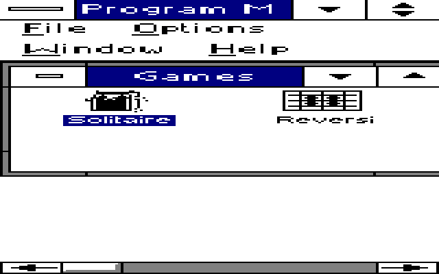
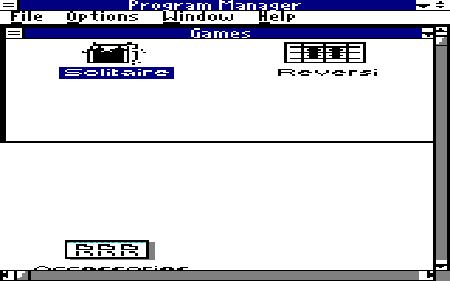
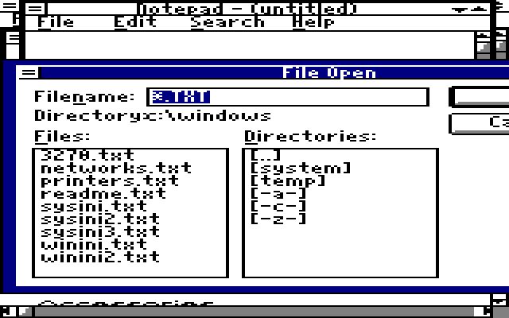
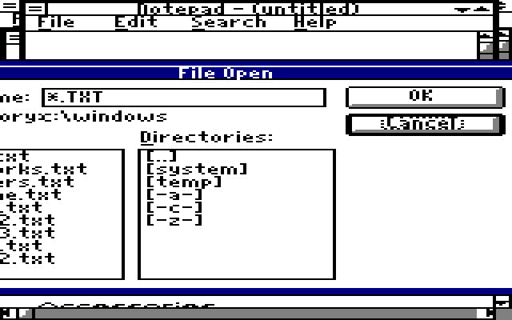
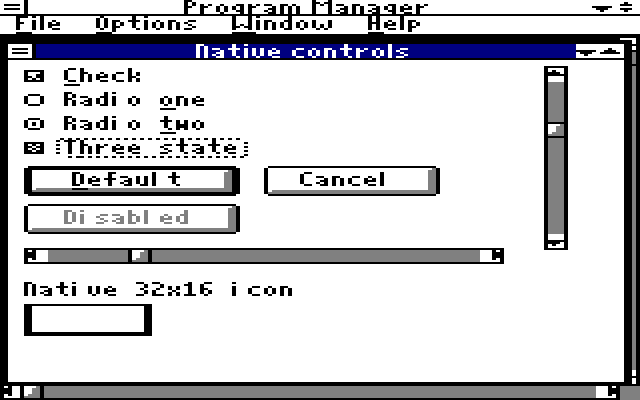

# Compact160 fonts and controls

An opt-in Windows 3.0 real-mode profile for 160x200 graphics: original readable
eight-row fonts, compact OEM controls and optional focus-following navigation
for known oversized dialogs. Existing packages and 320/640 profiles stay intact.
**Calculator is unsupported.** This is an experimental source candidate with
software-rendering evidence, not a hardware-qualified download.

## Before and after

| Baseline | Compact |
| --- | --- |
|  |  |

These are actual Windows screen-DC captures inside DOSBox-X, with the same
explicit maximize action. **They are GDI software rendering, not physical
Yamaha output or Yamaha scanout emulation.** The raw images are 160x200;
presentation PNGs use nearest-neighbor 4x2 scaling, giving the dimension-derived
2:1 displayed pixel aspect of the existing Yamaha reference. This does not
measure physical video timings. [Raw pixels and hashes](EVIDENCE.JSN).

## What changes

Five fonts are built from original MIT glyph grids, reusing the project's
XTFONTS writer and drawing rules. No Microsoft/ROM font bitmap is extracted,
and no raster is shrunk. Common advances become four pixels while height
stays eight. Variable System/Helv have wider M/W drawings; FixedSys, Terminal
and Courier remain fixed width. OEM covers its advertised CP437 01..FE range;
nine reserved/unsupported ANSI codes retain visible fallback.

Graphics controls use 6x7 caption buttons and 6x8 scroll/check/radio tiles.
The OEM checkbox atlas retains twelve distinct states. Icon compression stays
at inherited X=2/Y=4, cursor compression is unchanged, and USER icons remain
32x16. The driver overlay changes only resource descriptors and appended
resources; original executable code, relocations, memory profiles and timings
are preserved.

| Measured native Windows metric | Baseline | Compact |
| --- | ---: | ---: |
| System average / maximum advance | 7 / 14 | 4 / 6 |
| Horizontal / vertical dialog base | 8 / 8 | 4 / 8 |
| Caption / menu height | 16 / 14 | 9 / 9 |
| Caption button | 27x14 | 6x7 |
| Vertical scrollbar width | 18 | 6 |
| `File Options Window Help` text extent | 167 | 84 |

## Separate targets

| Build target | Exact baseline | Generated driver | Evidence scope |
| --- | --- | --- | --- |
| `yamaha-b800` | Candidate03 `YAM160.DRV` | `C16B800.DRV` | Windows API plus software GDI captures |
| `pc1-b000` | Candidate03 `PC1YAMA.DRV` | `C16B000.DRV` | Separate Windows API/rollback tests only |

Both share the geometry generator but retain independent source pins and
memory profiles. B800 success does not qualify PC1 hardware. Tandy160 is
deferred pending guarded-launcher compatibility. Input/output hashes are in
[EVIDENCE.JSN](EVIDENCE.JSN).

## Build and check

Use Python 3.9+ and Pillow on the modern host, from a checkout containing the
existing pinned Yamaha Candidate03 archives. Every output path must be fresh.
No Python runs on the vintage machine. These commands launch no emulator.

```
python -B experiments/COMPACT/HOST.PY BUILD.PY --target yamaha-b800 --out ../C16B800
python -B experiments/COMPACT/HOST.PY BUILD.PY --target pc1-b000 --out ../C16B000
python -B experiments/COMPACT/HOST.PY TEST.PY --out ../C16TEST
```

The offline suite checks deterministic builds, preservation outside resource
descriptors, FNT/NE bounds and coverage, distinct control states, unchanged
normal profiles, target refusal, custom-shell preservation, interrupted-install
recovery and exact rollback with intervening-edit protection. It passes 17
grouped checks, or 19 with the optional locally built helper:

```
python -B experiments/COMPACT/HOST.PY TEST.PY --out ../C16TEST2 --dialog-helper ../PRIVATEBUILD/C16VIEW.EXE
```

Modern Windows can also run `HOSTGDI.PY --out ../C16GDI` through HOST.PY. Its
five process-private font aliases and 475 ASCII raster comparisons test font
format/metrics; they are not Windows 3.0 output qualification.

## Install on an offline private clone

Start with an already-working disposable Windows 3.0 real-mode clone using the
exact selected Candidate03 driver, installed through its existing Setup/Other
route and your owned support files. Stop and detach the guest before copying
its Windows directory into an ordinary host workspace directory. PREP cannot
establish that a guest is offline itself. Do not target host Windows, CF,
block devices, source media, or a live/mounted guest.

```
python -B experiments/COMPACT/HOST.PY PREP.PY on --offline-private-clone --windows ../PRIVATE/WINDOWS --packet ../C16B800 --target yamaha-b800
```

PREP verifies driver and packet hashes, copies separate compact filenames,
selects them in SYSTEM.INI and adds two WIN.INI font aliases, BorderWidth=1
and GridGranularity=0. It preserves unrelated entries and existing fonts and
drivers. For the standard PROGMAN.EXE shell only, a recognized five-integer
saved placement keeps its normal rectangle and sets maximized startup, so
wide-desktop coordinates do not hide the window. Other shells and unknown
formats are unchanged. No manual INI edits are needed.

The durable C16STATE.JSN journal saves exact original bytes before mutation.
To roll back, stop/detach/extract the same clone and run:

```
python -B experiments/COMPACT/HOST.PY PREP.PY off --offline-private-clone --windows ../PRIVATE/WINDOWS
```

Rollback restores original bytes and removes only transaction-owned new files.
It refuses intervening edits; preserve and reconcile them before retrying.
The restored journal remains for review. App-created documents remain user
data. An interrupted host write may leave a .C16TMP file; inspect it rather
than deleting unknown evidence. Generated OEMSETUP.INF is not native Setup
acceptance. B800/B000 retain their own startup paths; do not add a Tandy launcher.

## Optional focused-dialog navigation

Notepad Open still measures 202x148 pixels and Program Manager About 185x128.
Their explicit 8pt Helv dialog-unit templates exceed this screen. C16VIEW
reveals a focused child by moving the whole dialog, without changing fonts,
child sizes, application files or input. It uses a 250ms timer and no global
input hook. It operates only at 160x200 on an 8086-class real-mode installation,
on visible #32770 dialogs with these exact titles and owner classes:

- Titles: About, About Notepad, About Calculator, About Paintbrush, File Open,
  File Save, File Save As, Save As, Notepad.
- Owners: Progman, Notepad, SciCalc, Calc, PBrush, pbParent.

Tab/Shift-Tab or an application's own navigation can reach fields/buttons;
the helper reveals the focused pane as needed. Other portions may remain
off-screen. It cannot fit an oversized static label or a control larger than
the screen, and does not resize application main windows.

| Filename field focused | Cancel focused and revealed |
| --- | --- |
|  |  |

Build C16VIEW.C/DEF/BAT with the existing pinned external toolchain described
in [BUILDDEPS](../../tools/BUILDDEPS/README.MD). In a separately allocated,
bounded emulator slot, map that toolchain to T: and a fresh source copy to D:;
run `D:\C16VIEW.BAT`. The recipe uses /G0 /Gw /AS, LINK4 and LIBW/SLIBCEW.
The expected helper SHA256 is pinned in PREP.PY and EVIDENCE.JSN. An unknown
helper build is refused before mutation. No helper binary is distributed here.

To include it in the same reversible transaction, append this to PREP `on`:

```
--dialog-helper ../PRIVATEBUILD/C16VIEW.EXE
```

PREP appends C16VIEW.EXE to the existing WIN.INI load entry and journals it.
Run `C16VIEW.EXE /OFF` in the guest to stop it for that session; offline rollback
restores startup bytes. The helper creates no log unless launched with /LOG.

## Validation and limits

[Evidence summary](EVIDENCE.JSN) records distinct B800/B000 API tests and
exact baseline cold metrics after rollback, selected font faces, native control
states, caption hit codes and message-level window actions. Notepad Save As
contents, Open/Cancel and dialog-manager Tab/Escape were checked. The final
focus-only run exposed Cancel at x108..158 and restored all 119 pre-test
Windows files exactly. These are guest API/message checks, not physical input.



**Calculator is unsupported:** its fixed owner-drawn layout clips in an 88x134
window. An attempted width adjustment had an incomplete first paint; it was
removed after failed repaint checks. No Calculator resize or repaint workaround
is included in this candidate.

Actual Yamaha scanout, physical PC1, physical mouse/keyboard hit/drag/repeat,
native OEM Setup, Paintbrush drawing/Save and fresh 320/640 GUI regression
remain unqualified. Existing normal-profile bytes are preserved. Arbitrary
dialog layouts, explicit app fonts, long paths and translations may still clip.
The candidate does not promise that every application dialog fits.

All font grids and new helper/tool source use the included MIT license.
Inherited drivers retain their existing terms. This source diff contains no
Windows/DOS binaries, proprietary extracted font/bitmap assets, ROM, compiler,
emulator, guest image or private review bundle. Screenshots are the requested
evidence from licensed private test fixtures.
