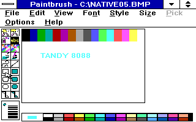

# Candidate05 DIB correction

Candidate04 could display colored Paintbrush strokes but failed the later
save/reopen check: saved pixels became monochrome and reopening produced
stripes. Its missing DIB capabilities were a correctness defect. The frozen
candidate04 is retained for comparison; it is not the current DIB result.

## Implementation

PORTDIB.PY runs after PORT8086.PY in a fresh build stage. It verifies four
additional original DDK inputs by SHA256, stages the existing BMC_MAIN,
BMC_ETI and BMC_ITE memory converters, and adds these exports:

- Ordinal 19 DeviceBitmapBits, ordinal 20 CreateBitmap: RC_DI_BITMAP
- Ordinal 21 DIBScreenBlt: RC_DIBTODEV, implemented by SDIB88.ASM

The bundled DDK DOCUMENT/DDAG31.TXT lines 1543-1545 explicitly says GDI uses
monochrome bitmaps to simulate DIB conversion without RC_DI_BITMAP.

The new screen routine converts one source row at a time through the memory
converter, then the original memory BitBlt writes the planar shadow buffer.
There is one final FlushShadow. Neither the original hardware EGA DISCREEN
nor RLEBitBlt is linked. The temporary fixed allocation is zero-initialized,
private, and freed on every exit:1064 bytes for header/palette plus at most
16384 bytes for one scan-interleaved four-plane row. The caller's header and
palette are never rewritten. Pointer arithmetic includes huge-segment carries.

At the Candidate05 revision documented here, native screen input was a 40-byte
BITMAPINFOHEADER, positive dimensions up to 32767 subject to checked
stride/offset bounds, and BI_RGB depths 1/4/8/24. That revision rejected
nonzero compression; its other limits do not assert exhaustive malformed-input
validation in inherited DDK memory-conversion routines.

Source-Y is bottom-left, as specified by the Windows 3 SDK. The supplied band
starts at StartScan, not at the full DIB origin. See ORACLE.MD for the original
failed top-left expectation, preserved input artifacts, exact correction, and
independent SDK/DDK/stock-CGA cross-check. No driver geometry was changed to
make the corrected expectation pass.

## Candidate05 verification

Driver:51296 bytes
SHA256:ac1aadce894058ab6dbdeab2d2a3fd8673a8b4e78d8798198d295f61f32dafee
Two independent full builds produce identical bytes. All 27 objects and 13707
emitted listing rows pass the strict 8086 and linked-byte closure audits.

Completed on that hash:
- ROUND2: odd 37x11 image, all407 pixels, partial band and guards
- ROUND3: BI_RGB 1/4/8/24 GetDIBits, SetDIBits, CreateDIBitmap, direct screen
- ROUND4:56 clipped/banded/depth/compression cases;1835008 raw framebuffer bytes
- ROUND5:8 warmups and64 measured calls, no call failures or heap growth
- CPU128 save-frame/FLAGS cases and4096 generated rotations
- Video reservation24 checks and full framebuffer conversion suite

Native Paintbrush save/reopen passed on a 200x120 sixteen-color image with
newly entered cyan TANDY8088 lettering. The saved BMP keeps all 16 colors and
the untouched bar pixels. Reopening matches all 24,000 canvas pixels exactly
after the display palette mapping. The native capture is320x200.
Fresh post-save/reopen metrics confirm 320x200, BITSPIXEL=1, PLANES=4,
NUMCOLORS=16 and BIOS 09. The full drawing and 12-case SRCCOPY probes each match
all 64000 pixels. Interactive clean exit, Windows restart, Program Manager
restore/maximize, and final clean exit passed.

Tests use Windows 3.0 real mode, Tandy normal 640 KB with RESERVE, enforced
8086_prefetch CPU semantics, and fixed 20000 emulator cycles. This is not
physical-hardware or cycle-exact bus-timing validation. Full redraw is slow;
Paintbrush interactions can take 10-20seconds under this test configuration.
No performance optimization is part of the DIB correction.

## Current staged extension: BI_RLE4 and BI_RLE8

The run41 candidate adds matching-depth BI_RLE4 (4bpp) and BI_RLE8 (8bpp)
input to the actual Windows 3.0 `DeviceBitmapBits` / `SetDIBits` memory path
and `DIBScreenBlt` / `SetDIBitsToDevice` shadow-backed screen path. The parser
uses nonzero `biSizeImage` as its hard input bound because the 40-byte Windows
3.0 DIB ABI has no separate compressed-buffer length. It validates the whole
stream through EOB before writes, then streams one expanded scanline at a time;
there is no whole-image allocation. BI_RLE4 alternates high/low nibbles in
encoded runs. Both formats handle absolute runs, word padding, EOL, EOB and
delta, with clipping, palette translation, and bottom-up scan order. Unsupported
compression/depth pairs, truncated input and malformed streams fail closed.

`RLE88.ASM` is the shared bounded decoder, `PORTDIB.PY` connects it to the
existing DIB entrypoints, and `SDIB88.ASM` retains the screen bridge's shadow,
flush, pan and cursor contracts. The 8086 build audit checks the emitted
listing and ABI helper. `RLETEST.PY` compares fixtures against a separate
stream oracle and Pillow's uncompressed BMP path; the Win3 matrix and full-frame
checker sources are `MODETEST.C` and `MODECHK.PY`.

Qualification is recorded in `docs/RLE-RUN41-QUALIFICATION.md`. Run41 exercised
an emulator's original 8088 core in Windows 3.0 real mode, at logical
640x256x16 with a 320x200 view and 640 KB. It is not physical-hardware, other
profile, default-payload, or performance qualification. The screen capture for
case146 is a pre-call case-start image; pixel proof is the saved post-call
framebuffer and full-frame checker. The callback-entry observer was unarmed and
is inconclusive.
